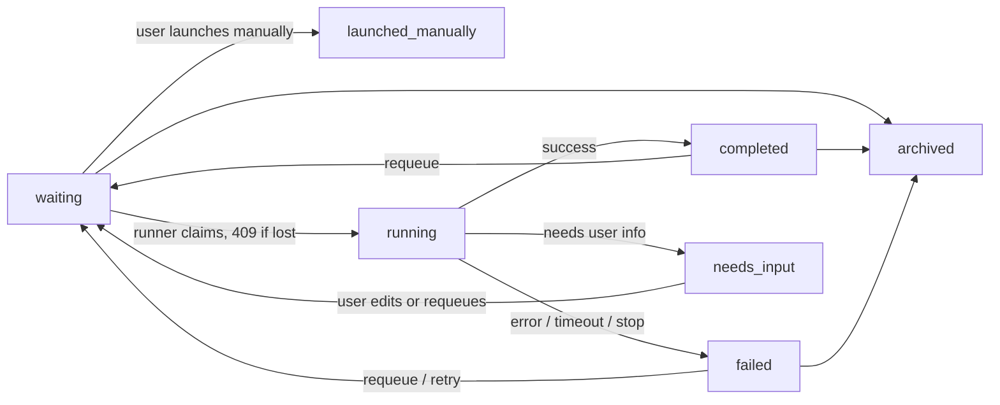
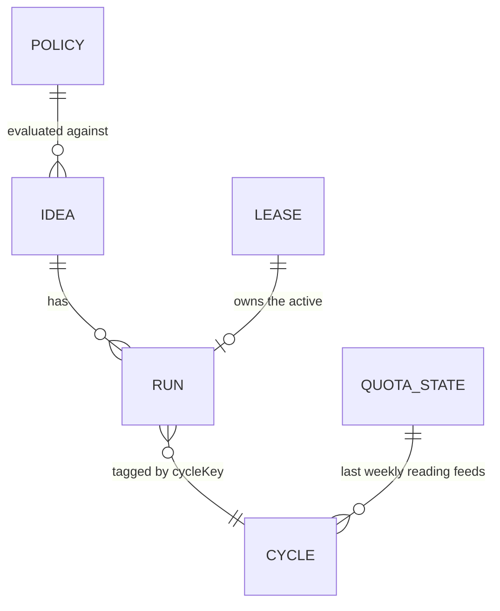

# Data Model: surplus-runner

All records are plain JSON. Locally they live in `localStorage` under `kairos:surplus:*`; in shared mode each is also a `routing_config` shared record whose logical key is shown below (see [contracts/shared-records.md](contracts/shared-records.md)). Derived values (pressure, eligibility, cycle consumption, retry counts) are never stored.

## Quota timestamps (extension of existing quota state)

`state[serviceId]["__ts_" + quotaId]`: ISO-8601 string or `null`. Set when a quota value is entered or when the user confirms the displayed values. `null` means never confirmed, which is never fresh.

## Surplus Policy (`surplus-policy`, one per workspace)

| Field | Type | Default | Rule |
| --- | --- | --- | --- |
| `schemaVersion` | int | 1 | |
| `services.{id}.surplusEnabled` | bool | false | Only supported services (`claude`, `chatgpt`) accepted |
| `services.{id}.reservePct` | number | 20 | 0 to 90 |
| `services.{id}.windowDays` | int | 2 | 1 to 6 |
| `services.{id}.autoRunEnabled` | bool | false | Requires protected hours declared (FR-005) and `disclosuresAckAt` set |
| `services.{id}.disclosuresAckAt` | ISO or null | null | Set on first activation after the disclosures are shown (FR-012) |
| `protectedHours` | `[{days:[0..6], start:"HH:MM", end:"HH:MM"}]` | `[]` | `end` may be earlier than `start` (crosses midnight); local time |
| `costPct` | `{small, medium, large}` | `{3, 8, 15}` | Positive numbers, small <= medium <= large |
| `thresholds` | `{freshnessHours, sessionMaxAgeHours, sessionMinRoomPct, maxRunMinutes, evalIntervalMinutes}` | `{12, 5, 30, 60, 15}` | Positive numbers |
| `projectsBaseFolder` | string or null | null | Informational copy for the dashboard; the runner's own config is authoritative |

## Control (`surplus-control`)

`{ autoRunEnabled: bool, updatedAt: ISO }`. Global stop sets `autoRunEnabled=false`. Written by any client; the runner treats `false` as stop and only starts when it is `true` and its local config also allows it.

## Idea (`idea:{id}`)

| Field | Type | Rule |
| --- | --- | --- |
| `id` | string | Client-generated unique id |
| `text` | string | Required, non-empty |
| `context` | string | Optional, at most 10,000 characters (FR-026) |
| `workingFolder` | string or null | Typed or pasted, absolute or relative; stored as typed (FR-027) |
| `priority` | `high` / `normal` / `low` | Default `normal` |
| `size` | `small` / `medium` / `large` | Default `medium` |
| `approvalRequested` | bool | A request only. Never an authorisation (FR-013) |
| `contentVersion` | int | Incremented when `text`, `context` or `workingFolder` changes |
| `status` | enum | `waiting`, `launched_manually`, `running`, `completed`, `failed`, `needs_input`, `archived` |
| `order` | number | Manual ordering inside equal priority |
| `createdAt`, `updatedAt` | ISO | |
| `serviceId` | string or null | Set when `launched_manually` or `running` |
| `resultDecision` | `accepted` / `discarded` / `requeued` / null | Stored here because run records are immutable |
| `lastRunId` | string or null | Latest run for review |

**State transitions**

`launched_manually` is terminal except archive or requeue. Editing `text`, `context` or `workingFolder` bumps `contentVersion`; the runner's local hash no longer matches, so the approval is withdrawn, and the UI tells the user it must be approved again (FR-029).

## Run Record (`run:{id}`, immutable after finalisation)

| Field | Type |
| --- | --- |
| `id`, `ideaId`, `serviceId` | string |
| `ideaSnapshot` | `{text, context, workingFolder, resolvedFolder, contentVersion}` |
| `mode` | `auto` (manual launches create no run record) |
| `cycleKey` | `"{serviceId}:{nextResetDate}"` |
| `startedAt`, `endedAt` | ISO |
| `status` | `completed` / `failed` / `needs_input` / `interrupted` |
| `failureReason` | code + message (`tool_missing`, `not_signed_in`, `quota_exhausted`, `stopped_by_user`, `timeout`, `protected_hours`, `reset_day`, `billing_guard`, `folder_error`, `interrupted`) or null |
| `decisionInputs` | The evaluation result object of [contracts/evaluation.md](contracts/evaluation.md) at claim time (FR-020) |
| `estimatedCostPct` | number (size-class estimate) |
| `output` | string, at most 256 KB, with `truncated: bool` |
| `proposal` | `{diff: string (at most 256 KB), truncated, files: int}` or null |
| `localRunDir` | string, runner-local path shown for cleanup |

A run record is written once as `running` (claim) and rewritten exactly once on finalisation; after that it is never changed.

## Reset Cycle Record (`cycle:{serviceId}:{resetDate}`)

`{ serviceId, resetDate, lastWeeklyRemainingPct, readAt }`. Updated on each quota entry or confirmation while `readAt` is before the reset day starts. Derived at display time: reading age at reset (`resetDayStart - readAt`), approximate flag (age over the freshness limit), consumed by runs (sum of `estimatedCostPct` of run records with the same `cycleKey`). A service with fewer than one closed cycle shows "history too short" (as in 005).

## Runner Lease (`runner-lease`)

`{ designatedDeviceId, designatedDeviceName, designatedAt, deviceId, deviceName, startedAt, heartbeatAt, leaseSeconds, approved: {ideaId: contentVersion} }`. `designatedDeviceId` persists after the lease expires and changes only through `runner config --take-over` on the new device (FR-014). `approved` is display-only. A lease is expired when `now - heartbeatAt > leaseSeconds` (default 180).

## Runner-local files (`~/.kairos-runner/`, never synced)

| File | Content |
| --- | --- |
| `config.json` | `deviceId`, `deviceName`, `apiBase`, `workspaceId`, `projectsBaseFolder`, `allowServices`, `allowCodexAuto` (bool, default `false`; when not `true` Codex ideas are skipped with `codex_reads_uncontained`; not prompted by `config`, edited by hand), tool paths, copy exclusions, limits |
| `approvals.json` | `{ ideaId: { hash, approvedAt, preview } }` where `hash` = SHA-256 of canonical JSON of `{text, context, resolvedFolder}`; `resolvedFolder` is `null` for an idea without a working folder (empty scratch directory, FR-017) |
| `journal.jsonl` | Append-only `start` / `end` entries per run for restart idempotence |
| `runs/{runId}/` | Disposable copy, full output, diff; removable with `runner clean` |
| `STOP` | Sentinel file; its presence stops the runner |

## Relationships

