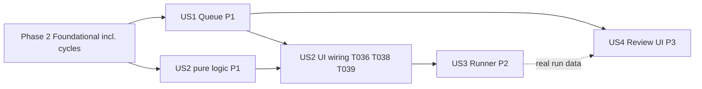

# Tasks: surplus-runner

**Input**: Design documents from `specs/006-surplus-runner/`
**Prerequisites**: plan.md, spec.md, research.md, data-model.md, contracts/evaluation.md, contracts/shared-records.md, contracts/runner-cli.md, quickstart.md

**Tests**: Included. Constitution Principle III and the spec's Verification Plan require a failing-first test for every rule, guardrail and state transition. Pure logic is tested with `node:test` in plain Node (inject `now`, never read the real clock, `localStorage` or network). UI-only behaviour that cannot reasonably be automated is verified through the manual steps in `quickstart.md`.

**Organization**: Grouped by user story. US1 and US2 are both P1 and together form the MVP (suggestion-only, no execution risk). US3 (runner) and US4 (review) build on them. Reset-cycle readings (FR-032) are recorded from the MVP onward so history accrues before the review UI ships.

## Format: `[ID] [P?] [Story] Description`

- **[P]**: Can run in parallel (different files, no dependencies on unfinished tasks)
- **[Story]**: US1 to US4, mapping to the user stories in `spec.md`
- Paths are relative to the repository root; written below with an `R/` prefix for brevity (`R/` = the repository root)

## Phase 1: Setup (Shared Infrastructure)

**Purpose**: Wire the new `src/surplus/` and `runner/` folders into scripts and lint before any code lands.

- [X] T001 [P] Add scripts `"runner": "node runner/index.js"` and `"test:runner": "node --test runner/"` to `R/package.json`, and make `"test"` run `test:frontend`, `test:backend` and `test:runner` (no new dependency)
- [X] T002 [P] Extend `R/eslint.config.js` so `runner/**/*.js` and `src/surplus/**/*.js` lint as Node ES modules (Node globals for `runner/`), keeping the rule that unused variables must be prefixed `_`
- [X] T003 [P] Create `R/src/surplus/constants.js` exporting `RULESET_VERSION = 1`, the status enum (`waiting`, `launched_manually`, `running`, `completed`, `failed`, `needs_input`, `archived`), priority enum (`high`, `normal`, `low`), size enum (`small`, `medium`, `large`), supported service ids (`claude`, `chatgpt`) and the documented defaults from research D13 (reserve 20, window 2, cost 3/8/15, freshness 12 h, session max age 5 h, session min room 30, max run 60 min, eval interval 15 min, stop watcher 5 s, quota watcher 60 s, context limit 10000, copy limit 1 GB, output cap 256 KB)
- [X] T004 [P] Create `R/runner/` directory with an empty `R/runner/fixtures/` folder and a placeholder `R/runner/README.md` pointing to `specs/006-surplus-runner/contracts/runner-cli.md`

---

## Phase 2: Foundational (Blocking Prerequisites)

**Purpose**: Local-calendar day count, quota reading timestamps, per-service surplus metadata and the pure domain modules every story uses.

**CRITICAL**: No user story work can begin until this phase is complete.

### Day basis and quota timestamps

- [X] T005 [P] Add failing tests to `R/src/utils.reset.test.js` for `getResetInfo` near local midnight: set `process.env.TZ` to `Pacific/Auckland` and to `America/Los_Angeles`, pass a `now` at 00:30 and 23:30 local, and assert `daysRemaining` equals the local calendar-day difference (not the UTC one); keep all existing assertions
- [X] T006 [P] Add a failing before/after recommendation scenario to `R/src/utils.reco-reset.test.js` (constitution: routing changes need a before/after scenario): with `TZ=Pacific/Auckland` and `now` at 00:30 local, a service whose next reset is local day D+2 must produce the note "Resets in 2d" (before the fix the UTC basis reports 3d); also assert the rule `reason` text for one task at 23:30 local is unchanged
- [X] T007 Change `getResetInfo` in `R/src/utils.js` to derive "today" from the local calendar fields of `now` (research D3), leaving its return shape and the other helpers unchanged; run `node --test src/` and confirm features 003 and 004 tests still pass (depends on T005, T006)
- [X] T008 [P] Add failing tests in `R/src/stateTransitions.quota-stamps.test.js`: `applyQuotaUpdate(prev, serviceId, quotaId, value, now)` sets `state[serviceId]["__ts_" + quotaId]` to `now.toISOString()` and leaves other quotas' stamps unchanged; `confirmQuotas(state, serviceId, now)` stamps every quota of that service without changing any value; `buildDefaultState` seeds every stamp as `null`; `applyQuotaRecord` applies a `quota_state` record whose logical key is `claude:__ts_weekly`
- [X] T009 Implement in `R/src/utils.js` the exports `QUOTA_TS_PREFIX = '__ts_'` and `quotaTimeKey(quotaId)`; in `R/src/stateTransitions.js` make `now` a required parameter of `applyQuotaUpdate` and `confirmQuotas` (the hooks pass `new Date()` at their call site; the pure functions never read the clock), and seed null stamps in `buildDefaultState` (depends on T008)
- [X] T010 [P] Add a `surplus` block to the `claude` and `chatgpt` entries of `R/src/data/services.js`: claude `{ weeklyQuotaId: 'weekly', sessionQuotaId: 'slot5h', tool: 'claude' }`, chatgpt `{ weeklyQuotaId: 'codex_remaining', sessionQuotaId: 'codex_5h', tool: 'codex' }`; other services get no `surplus` block (out of scope in v1 per spec Assumptions)
- [X] T011 [P] Update `R/src/hooks/useQuotaState.js` to stamp with `new Date()` on quota update, expose `confirmQuotas(serviceId)`, include stamp keys when loading defaults from localStorage, and keep `resetAll` seeding null stamps (keep in step with T012 per `docs/agents/frontend.md`; depends on T009)
- [X] T012 [P] Update `R/src/hooks/useSharedQuotaState.js` the same way: stamp on `updateQuota`, sync `__ts_*` keys as `quota_state` records with logical key `{serviceId}:__ts_{quotaId}` (including `buildDefaultEntries` and `resetAll`), expose `confirmQuotas(serviceId)` that writes every quota stamp of the service; do not add new `exhaustive-deps` warnings (depends on T009)
- [X] T013 [P] Update `R/src/services/localExport.js` so the migration payload includes the `__ts_*` entries like `RESET_DATE_KEY`, and confirm `R/backend/src/services/localstorage-import-mapper.js` accepts those logical keys; add `R/src/services/localExport.stamps.test.js` (depends on T009)

### Pure domain modules

- [X] T014 [P] Add failing tests in `R/src/surplus/time.test.js` then implement `R/src/surplus/time.js`: `resetDayStart(nextResetDate)` (local midnight Date), `nextProtectedStart(protectedHours, now)` (handles ranges crossing midnight and day-of-week lists), `isInProtectedHours`, `hardStopAt(now, policy, nextResetDate)` = minimum of `now + maxRunMinutes`, next protected start and reset-day start
- [X] T015 [P] Add failing tests in `R/src/surplus/policy.test.js` then implement `R/src/surplus/policy.js`: `defaultPolicy()` and `validatePolicy()` enforcing `services.{id}.reservePct` 0 to 90, `windowDays` int 1 to 6, `costPct` positive with small <= medium <= large, only supported services accepted, `autoRunEnabled` rejected unless `protectedHours` is declared and `disclosuresAckAt` is set (FR-005, FR-012), protected-hours format `{days:[0..6], start:"HH:MM", end:"HH:MM"}`
- [X] T016 [P] Add failing tests in `R/src/surplus/paths.test.js` then implement `R/src/surplus/paths.js` (lexical only, no filesystem access, so the browser can import it): `classifyFolder(input)` returns `absolute` or `relative` or `empty`; `resolveFolder(input, baseFolder)` returns the resolved path or `{error: 'folder_missing_base'}`; `isRefusedLocation(path, homeDir)` refuses `/`, the home folder itself and the system roots listed in research D10 (FR-030)
- [X] T017 [P] Add failing tests in `R/src/surplus/ideas.test.js` then implement `R/src/surplus/ideas.js`: `createIdea` with `text` required non-empty, `context` at most 10,000 characters (reject with a message, FR-026), `workingFolder` stored as typed (FR-027), `priority` default `normal`, `size` default `medium`, `status` default `waiting`, `contentVersion` starting at 1; `editIdea` bumps `contentVersion` when `text`, `context` or `workingFolder` changes and returns `approvalWithdrawn: true` (FR-029); `transitionIdea` enforcing the state diagram in `data-model.md` (invalid transitions throw); `reorderIdeas`; `validateIdeaRecord` for payloads read from the shared store (type, enum and length checks; invalid records are returned in an `invalid` list, never run)
- [X] T018 [P] Add failing tests in `R/src/surplus/records.test.js` then implement `R/src/surplus/records.js`: logical-key builders and parsers for `surplus-policy`, `surplus-control`, `idea:{id}`, `run:{id}`, `cycle:{serviceId}:{resetDate}`, `runner-lease`, and validators for run records (`output` at most 256 KB with `truncated`, enums for `status` and `failureReason`), cycle records, control payloads and lease payloads including `designatedDeviceId` (contracts/shared-records.md)
- [X] T019 [P] Add failing tests `R/src/surplus/cycles.test.js`: `recordCycleReading(cycles, {serviceId, nextResetDate, weeklyRemainingPct, readAt})` keeps only the last reading taken before the reset day starts and ignores a later one; `summariseCycles` returns per cycle the quota left at reset, reading age at reset, `approximate: true` when that age exceeds the freshness limit, and consumed by runs as the sum of `estimatedCostPct` of runs with the same `cycleKey`; fewer than one closed cycle gives "history too short"
- [X] T020 Implement `R/src/surplus/cycles.js` (depends on T018, T019, T014)

**Checkpoint**: Day count is local-calendar, quota readings carry timestamps and sync, and the pure domain modules (including cycle logic) exist with tests. User stories can start.

---

## Phase 3: User Story 1 - Capture Non-Urgent Ideas On The Fly (Priority: P1)

**Goal**: A local-first, optionally shared idea queue with context, working folder, priority, size, edit, reorder, archive and delete. Reset-cycle readings are recorded from now on.

**Independent Test**: Capture ideas with different priorities, sizes, context and folders; edit, reorder, archive one; reload and see the same queue; with shared mode on, another device sees it (quickstart section 3 steps 1 to 3).

### Tests for User Story 1

- [X] T021 [P] [US1] Add failing tests in `R/src/surplus/storage.test.js`: serialise and load ideas, policy, runs and cycles from an injected storage object under keys `kairos:surplus:*`; corrupt JSON loads as empty; `applySurplusRecords(base, items)` ignores `quota_state` and `snapshot` records and any `routing_config` key outside the known namespaces; a stale shared idea does not overwrite a newer local edit (field-wise merge: user-owned fields vs runner-owned `status`, `serviceId`, `lastRunId`); invalid records are listed, not applied
- [X] T022 [P] [US1] Add characterisation contract test `R/backend/tests/contract/surplus-records.contract.test.js` using `tests/helpers/test-app.js` and a throwaway DB (it documents existing behaviour and is expected to pass at once): create, update with `expected_version`, 409 on stale version, list with `since`, soft-delete for each logical-key namespace of `routing_config`, and assert that `quota_state` and `snapshot` records in the same workspace are unaffected

### Implementation for User Story 1

- [X] T023 [US1] Implement `R/src/surplus/storage.js` (pure, storage injected): keys, load, save, `applySurplusRecords`, field-wise merge and the invalid-record list (depends on T017, T018, T021)
- [X] T024 [US1] Implement `R/src/hooks/useSurplusStore.js`: local-first state for ideas, policy, runs, cycles, control and lease; actions `addIdea`, `updateIdea`, `reorder`, `archiveIdea`, `deleteIdea` (soft-delete in shared mode), `requestApproval`, `markLaunchedManually`; in shared mode debounce 220 ms and write `routing_config` records via `createRecord` / `updateRecord`, pull via `syncPull` with a stored cursor, handle 409 by refresh and one merge retry; works with no workspace and no network (FR-003, FR-023); reuse the workspace id from `getWorkspaceId()` and add no new `exhaustive-deps` warnings (depends on T023)
- [X] T025 [P] [US1] Create `R/src/components/IdeaCapture.jsx` and `IdeaCapture.module.css`: single text field plus Enter to confirm (idea appears as waiting within three interactions, SC-001), expandable section for context (character counter, message at the 10,000-character limit), working folder text field (typed or pasted, no browse dialog), priority and size selectors, "request automatic-run approval" checkbox, and, when shared mode is on, a visible notice that ideas are stored in the shared store and readable by any device on the local network while shared-store access is unauthenticated (FR-024)
- [X] T026 [P] [US1] Create `R/src/components/IdeaQueue.jsx` and `IdeaQueue.module.css`: list ordered by priority then manual order, inline edit of every field, reorder controls, archive, delete, archived view, status chips, visible context and folder in the details (as typed, with the note "checked only on the runner device"), notice "approval withdrawn, must be approved again" after an edit of an approved idea, a list "awaiting approval" with exact text, context and folder, "invalid record" entries, and no shared-store notice of its own (the notice of T025 appears once, in "New idea", not repeated in the queue)
- [X] T027 [US1] Mount `IdeaCapture` and `IdeaQueue` in `R/src/App.jsx` using `useSurplusStore`, with a message when shared mode is off that the queue works but automatic runs are unavailable (FR-023)
- [X] T028 [US1] Record reset-cycle readings (FR-032) in `R/src/hooks/useSurplusStore.js`: when a service's weekly-quota stamp changes (value entered or "still current" confirmed) and its reset date is valid, call `recordCycleReading` from `R/src/surplus/cycles.js` with `now` passed from the hook edge and persist the `cycle:{serviceId}:{resetDate}` record local first, synced in shared mode, so history accrues from the MVP release (depends on T020, T024)

**Checkpoint**: The queue is usable on its own, offline, and syncs in shared mode; cycle history starts accumulating.

---

## Phase 4: User Story 2 - See Expiring Surplus And Get An Explained Suggestion (Priority: P1)

**Goal**: A deterministic evaluation that says which service has expiring quota and which idea fits, with every rule outcome, a copyable instruction and a manual "launched" confirmation. Nothing is executed.

**Independent Test**: Set quota and reset dates to known values and check eligibility and reasons per rule (quickstart sections 2 and 3).

### Tests for User Story 2

- [X] T029 [P] [US2] Add failing tests in `R/src/surplus/evaluation.test.js` with one passing and one failing case for each rule: R1 surplus off; R2 reset unset / invalid / future / due today / overdue / beyond window / inside window; R3 weekly data 11 h and 13 h old and `null` stamp; R4 remaining equal to and just below `reserve + cost`; R5 session reading 4 h and 6 h old, 30% and 29% remaining; R6 run reaching protected hours and reaching the reset day; R7 no waiting idea
- [X] T030 [P] [US2] Add failing tests in `R/src/surplus/evaluation.selection.test.js`: order priority > largest size that fits `remaining - reserve` > oldest `createdAt` > `id`; service order by soonest reset then `SERVICES` order, with alternatives listed; ideas with a failing `folderChecks` entry skipped with a reason; an idea with a failed or interrupted auto run in the same `cycleKey` skipped (FR-018); two ideas with the same resolved folder never both selected; determinism (same input gives deep-equal output, SC-002); `reason` never empty; no-idea and no-service states state why (US2 scenario 5)
- [X] T031 [P] [US2] Add failing scenario tests in `R/src/surplus/evaluation.scenario.test.js` for the before/after case in `quickstart.md` section 2 (60% remaining, reset in 2 days, confirmed 2 h ago, 5 h slot 60% remaining, one medium idea gives a suggestion; 20 h old gives none with reason; reset due today gives none with reason), plus a consistency test asserting that for every eligible service the routing rules in `R/src/data/rules.js` do not treat that service as blocked and the feature 004 note "Resets in Nd" agrees with the notice (research D14); and a midnight test that `getResetInfo` and the evaluation return the same `daysRemaining` at 23:59 and 00:01 local
- [X] T032 [P] [US2] Add failing tests in `R/src/surplus/instruction.test.js`: `buildManualInstruction(idea, service)` includes the idea text, the context, the working folder as typed, and the official tool command for the service; pure and deterministic (FR-011)

### Implementation for User Story 2

- [X] T033 [US2] Implement `R/src/surplus/evaluation.js` per `contracts/evaluation.md`: `evaluateSurplus`, rules R1 to R7 in fixed order with `{id, pass, detail}`, selection, `skipped` reasons, `reason` strings; normalise quotas to remaining percentage with `100 - getConsumedPct(...)`; reuse `getResetInfo`; no `Date.now()`, no browser or Node-only globals (depends on T014, T015, T017, T029, T030, T031)
- [X] T034 [P] [US2] Implement `R/src/surplus/instruction.js` (depends on T032)
- [X] T035 [P] [US2] Update `R/src/components/ServiceCard.jsx` and its CSS module to show the age of each quota reading and a one-action "Still current" button calling `confirmQuotas(serviceId)` (FR-031; depends on T011, T012)
- [X] T036 [US2] Create `R/src/components/SurplusNotice.jsx` and `SurplusNotice.module.css` (depends on T024 for store actions): per service the notice (quota expected to expire, suggested idea, rationale), expandable rule outcomes with inputs (FR-009), alternatives, preview of what would launch now without launching (FR-010), prompt to update or confirm quota when data is stale, copyable instruction block, "Mark as launched manually" confirmation calling `markLaunchedManually`
- [X] T037 [P] [US2] Create `R/src/components/SurplusSettings.jsx` and `SurplusSettings.module.css`: per supported service toggles and values for surplus use, reserve, window days, plus protected hours editor, size-class cost calibration, projects base folder, the standing notice that provider rules on automated usage can change (FR-025), and a "suggestion-only for all services" switch; the automatic-run toggle and global stop are added in US3 (T058)
- [X] T038 [US2] Wire evaluation into `R/src/hooks/useSurplusStore.js`: expose `evaluation` computed with `evaluateSurplus` on open, on quota or idea or policy change, and on a 60 s timer while the page is visible, with `now` passed from the hook edge; no stored derived state (FR-033, depends on T033)
- [X] T039 [US2] Mount `SurplusNotice` and `SurplusSettings` in `R/src/App.jsx` beside the recommendation section so both appear together without conflicting advice for the same service

**Checkpoint**: MVP complete. The user gets explained, reproducible suggestions, launches ideas by hand, and cycle history accrues.

---

## Phase 5: User Story 3 - Let Kairos Run Approved Ideas Automatically Within Guardrails (Priority: P2)

**Goal**: An opt-in local runner, designated per workspace, that starts exactly one locally approved idea when every rule and guardrail holds, inside a disposable copy, with stop controls.

**Independent Test**: Quickstart section 4: enable one service, approve one idea on the runner, put the reset in the window and see exactly one run; break each guardrail in turn and see no run.

### Tests for User Story 3

- [X] T040 [P] [US3] Create test fixtures `R/runner/fixtures/fake-cli.js` (a script that prints configurable output, can sleep, can exit non-zero, and records its cwd, argv and env to a file; also fake `auth status` / `login status` output modes: subscription, API key, unparseable) and `R/runner/fixtures/fake-api.js` (an in-memory HTTP server implementing the records endpoints with `expected_version` and 409 semantics)
- [X] T041 [P] [US3] Add failing tests `R/runner/workdir.test.js`: refuses `/`, the home folder, system roots and a folder over the copy limit of 1 GB (use a lowered limit in the test); excludes `.env*`, `*.pem`, `*.key`, `id_rsa*`, `.npmrc`, `.netrc`, `.aws`, `.ssh`, `.gnupg`, `credentials*`, `secrets*`, `node_modules`, `.git/hooks` by default and honours config overrides; does not follow symlinks outside the folder; the original folder is byte-identical after a run; the diff lists changed files; reasons `folder_not_found`, `folder_not_readable`, `folder_missing_base`
- [X] T042 [P] [US3] Add failing tests `R/runner/approvals.test.js`: the stored hash is SHA-256 of canonical JSON of `{text, context, resolvedFolder}`; editing any of the three makes the approval invalid; an `approvalRequested` flag or a lease `approved` map arriving from the shared store never authorises (FR-013); approvals file mode is 0600; the `approve` prompt prints the exact text, context, resolved folder and the exclusion list before asking for `yes`
- [X] T043 [P] [US3] Add failing tests `R/runner/preflight.test.js`: `tool_missing`, `flags_unsupported` (the tool's `--help` lacks a required flag), `not_signed_in`; `billing_guard` when `ANTHROPIC_API_KEY`, `OPENAI_API_KEY` or `CODEX_API_KEY` is set, when `claude auth status --json` or `codex login status` reports an API-key login, and when the status output cannot be parsed (fail closed); the child environment is built from an allowlist and neither it nor the raw status output is ever logged
- [X] T044 [P] [US3] Add failing tests `R/runner/lease.test.js`: heartbeat every 60 s with `expected_version`, expiry after 180 s; first `start` writes `designatedDeviceId`; a second device's `start` exits with code 3 even when the first lease has expired (FR-014); `config --take-over` on the second device changes the designation and the first runner exits on its next heartbeat; a forged lease or designation written by another client can stop the runner but never starts a run
- [X] T045 [P] [US3] Add failing tests `R/runner/loop.guardrails.test.js` using the fixtures: exactly one run starts when all conditions hold; one failing guardrail at a time prevents any run and records the reason (stale data, protected hours, quota at reserve, idea not approved on this runner, folder missing or refused, billing guard, global stop via control record, `STOP` file, service not in `allowServices`, `disclosuresAckAt` missing, shared mode off, not the designated device); a tick that begins after the reset day has started starts nothing for that service and replays nothing (runner was down)
- [X] T046 [P] [US3] Add failing tests `R/runner/loop.lifecycle.test.js`: the hard stop kills the process at `min(maxDuration, protected hours, reset day)`; the 5 s stop watcher ends the process within 5 s of a `surplus-control autoRunEnabled=false` write or a `STOP` file (SC-007) while the 60 s quota watcher is separate; quota at reserve during a run stops it and keeps partial output; output over 256 KB is truncated with `truncated: true`; empty output is recorded as such; two ideas on the same folder never run concurrently; the evaluation interval defaults to 15 minutes and is configurable (FR-033)
- [X] T047 [P] [US3] Add failing tests `R/runner/loop.recovery.test.js`: claim is compare-and-set so a 409 starts nothing; at most one run per workspace; a restart after a crash finalises the unfinished journal entry as `interrupted`, returns the idea to a retriable state and does not start it twice; a failed idea is not retried automatically twice in the same cycle (FR-018); the run record is written once as `running` and rewritten exactly once on finalisation
- [X] T048 [P] [US3] Add failing tests `R/runner/adapters.test.js`: Claude adapter builds a non-interactive print-mode invocation with JSON output, `--permission-mode dontAsk`, an explicit allow-list of file tools without a shell tool, and a turn limit; Codex adapter builds `exec` with workspace-write sandbox, approvals never and the copy as working directory; the prompt contains only the idea text and context (FR-024); `parseResult` maps exit codes and outputs to `completed`, `failed`, `needs_input` and failure reasons

### Implementation for User Story 3

- [X] T049 [P] [US3] Implement `R/runner/config.js`: load and validate `~/.kairos-runner/config.json` (device id and name, API base, workspace id, projects base folder, `allowServices`, tool paths, exclusions, limits), the interactive exclusion editor (add or remove entries, FR-030) and `config --take-over`; create the directory with mode 0700 and files with mode 0600
- [X] T050 [P] [US3] Implement `R/runner/api-client.js`: list, pull since cursor, create, update with `expected_version` against the shared-state API, with no dependency and a request timeout; no credentials are sent or stored
- [X] T051 [P] [US3] Implement `R/runner/journal.js`: append-only `journal.jsonl` with `start` and `end` entries and a function returning unfinished runs
- [X] T052 [US3] Implement `R/runner/workdir.js` (depends on T041): folder checks using `src/surplus/paths.js`, size pre-walk with the same filter, disposable copy under `~/.kairos-runner/runs/{runId}/work`, read-only diff against the original capped at 256 KB, `clean`
- [X] T053 [US3] Implement `R/runner/approvals.js` (depends on T042): local approvals file, canonical JSON hashing with `node:crypto`, `approve` terminal prompt that prints exact text, context, resolved folder and exclusions and requires typing `yes`, `revoke`
- [X] T054 [US3] Implement `R/runner/preflight.js` and `R/runner/adapters/claude.js`, `R/runner/adapters/codex.js` (depends on T043, T048): required-flag checks against `<tool> --help`, two-layer billing guard (environment variables, then login-mode parse of `claude auth status --json` and `codex login status`, fail closed), signed-in check, allowlisted child environment, argv builders and `parseResult` as specified in `contracts/runner-cli.md` and research D5
- [X] T055 [US3] Implement `R/runner/lease.js` (depends on T044): persistent `designatedDeviceId`, claim and take-over, heartbeat with `expected_version`, expiry, publishing the display-only `approved` map in the lease record
- [X] T056 [US3] Implement `R/runner/loop.js` (depends on T045, T046, T047, T049 to T055): the tick algorithm in `contracts/runner-cli.md`, compare-and-set claim, `hardStopAt` timer with SIGTERM then SIGKILL after 10 s, the 5 s stop watcher (`STOP` file and `surplus-control`) and the 60 s quota watcher (reserve rule, lease and designation), configurable 15 minute tick, finalisation of the run record (written once as `running`, rewritten once), idea status update, cycle record upsert, journal end entry, restart recovery; reuse `evaluateSurplus` with `mode: 'auto'`
- [X] T057 [US3] Implement `R/runner/index.js` command dispatch for `config`, `start`, `approve`, `approvals`, `status`, `stop`, `clean` with exit codes 0, 1, 2, 3; `start` prints the disclosures and requires a prior `config`; `stop` writes the `STOP` file and sets `surplus-control autoRunEnabled=false`
- [X] T058 [US3] Add the automatic-run controls to `R/src/components/SurplusSettings.jsx`: per-service "automatic runs" toggle disabled until protected hours are declared and shared mode is on; first activation shows a disclosure dialog (idea text, context and the disposable copy go to the chosen provider when a run starts; anyone on the local network can read shared ideas while shared-store access is unauthenticated; provider rules can change) and sets `disclosuresAckAt` only after acknowledgement (FR-012); an always-visible global stop button writing `surplus-control autoRunEnabled=false` (SC-007)
- [X] T059 [P] [US3] Show runner state in `R/src/components/IdeaQueue.jsx` and `R/src/components/SurplusNotice.jsx`: designated device name, lease heartbeat age, the display-only approved map as an "approved on runner" marker per idea, "awaiting approval on the runner" for requests, and `running` status; the browser never treats the marker as authorisation
- [X] T060 [US3] Run the automatable parts of `quickstart.md` section 4 against `R/runner/fixtures/fake-api.js` and `fake-cli.js` (`npm run test:runner`), then perform the manual containment canary and the API-key-login billing check with a real signed-in tool and record the results in `R/specs/006-surplus-runner/verification.md` (done 2026-11-04: A Claude PASS; B Codex writes PASS, reads accepted and gated by `allowCodexAuto`; C and D PASS; E and F not run, optional for the user)

**Checkpoint**: Automatic runs work end to end behind every guardrail; browser-only suggestion mode is unchanged.

---

## Phase 6: User Story 4 - Review Results And Measure Recovered Surplus (Priority: P3)

**Goal**: Reviewable run records and per-reset-cycle measurement display of quota left at reset and consumption by runs (the cycle logic and recording already exist from Phases 2 and 3).

**Independent Test**: Quickstart section 5.

### Tests for User Story 4

- [X] T061 [P] [US4] Add failing tests `R/src/surplus/runs.test.js`: run records are read-only once finalised; `applyResultDecision(idea, 'accepted' | 'discarded' | 'requeued')` updates only the idea (`resultDecision`, `status`), never the run record, and accepting changes nothing outside Kairos; a failed run shows `failureReason` with its human-readable message; interrupted runs leave the idea retriable (FR-021)

### Implementation for User Story 4

- [X] T062 [US4] Implement `R/src/surplus/runs.js` with `applyResultDecision` and run helpers (depends on T061)
- [X] T063 [P] [US4] Create `R/src/components/RunReview.jsx` and `RunReview.module.css`: run list and detail with idea, service, start and end times, status, output shown as a draft, proposed changes as a diff, decision inputs from `decisionInputs`, failure reason; accept, discard, re-queue actions (FR-019, FR-020)
- [X] T064 [P] [US4] Create `R/src/components/CycleSummary.jsx` and `CycleSummary.module.css` using `summariseCycles` from `R/src/surplus/cycles.js`: quota left at reset, part consumed by runs, approximate marker, "history too short" message (FR-022)
- [X] T065 [US4] Mount `RunReview` and `CycleSummary` in `R/src/App.jsx`

**Checkpoint**: All four stories are independently testable and the feature is complete.

---

## Phase 7: Polish & Cross-Cutting Concerns

- [X] T066 [P] Update `R/docs/SECURITY.md`: runner threat model, approval on the runner device, runner designation, why the shared store never authorises, residual containment risk, two-layer billing guard, local file permissions
- [X] T067 [P] Update `R/docs/agents/architecture.md`, `R/docs/agents/frontend.md` and `R/docs/agents/testing.md` for `src/surplus/`, `runner/`, the `routing_config` namespaces and `npm run test:runner`
- [X] T068 [P] Update `R/docs/DEPLOYMENT.md` and `R/README.md` with how to configure, designate and start the runner, its prerequisites (subscription-signed-in `claude` / `codex`), that it is optional, and the standing notice on provider rules
- [X] T069 [P] Add `[UNRELEASED]` entries to `R/CHANGELOG.md`, including the `getResetInfo` local-day fix
- [X] T070 Measure and record in `R/specs/006-surplus-runner/verification.md`: evaluation of 200 ideas across both services under 16 ms; capture of a text-only idea in at most three interactions and under 10 s (SC-001); global stop effective in under 5 s from the runner reading it (SC-007)
- [X] T071 Run `npm run lint && npm test && npm run build` and walk through `R/specs/006-surplus-runner/quickstart.md` sections 1 to 6, fixing any failure; confirm no new runtime dependency in `R/package.json`
- [X] T072 Review the final diff for the spec's edge cases not covered by a test (service renamed or removed while ideas refer to it, very large output, shared mode off, relative path without base folder) and add the missing tests

---

## Dependencies & Execution Order

### Phase dependencies

- **Setup (Phase 1)**: no dependencies; all tasks parallel.
- **Foundational (Phase 2)**: after Setup; blocks every story. Internal order: T005 and T006 then T007; T008 then T009; T010 to T013 after T009 (T010 is independent); T014 to T019 independent of the quota-stamp tasks; T020 after T018, T019 and T014.
- **US1 (Phase 3)**: after Foundational. Delivers the queue and starts cycle recording (T028).
- **US2 (Phase 4)**: after Foundational; T036, T038 and T039 need the store from US1 (T024), so US2's pure-logic tasks (T029 to T035, T037) can run in parallel with US1 but its UI wiring waits for T024.
- **US3 (Phase 5)**: after US1 and US2 (needs `evaluateSurplus`, the store and the settings component).
- **US4 (Phase 6)**: after US1; real run data exists only after US3, but the review UI can be built and tested with fixtures first.
- **Polish**: after the stories in scope.

### User story dependencies

### Within a story

Tests first and failing, then pure modules, then hooks, then components, then mounting in `App.jsx`. `App.jsx`, `useSurplusStore.js` and `SurplusSettings.jsx` are touched by several stories, so those tasks are sequential.

### Parallel opportunities

- Phase 1: T001 to T004 together.
- Phase 2: T005 and T006 together; T008 alongside them; after T009, T010 to T013 together; T014 to T019 together.
- US1: T021 and T022 together; T025 and T026 together.
- US2: T029 to T032 together; T034, T035, T037 together.
- US3: T040 to T048 (all test files and fixtures) together; T049 to T051 together.
- US4: T063 and T064 together.
- Polish: T066 to T069 together.

## Implementation Strategy

### MVP first (US1 + US2)

1. Phase 1 and Phase 2 (including the local-day fix, which also corrects feature 004's display).
2. US1 then US2. Stop and validate with quickstart sections 2 and 3: the user already gets the waste-reduction value with no execution risk, and reset-cycle history is already accruing for SC-003.

### Incremental delivery

1. MVP above.
2. US3 behind explicit opt-in: ship only after the guardrail tests (T045 to T047) and the containment and billing checks (T060) pass.
3. US4 for trust and measurement (SC-003).
4. Polish and documentation.

### Notes

- Every rule change needs the before/after scenario (T006 for the day basis, T031 for the surplus rules); do not skip them.
- Commit per task or logical group using Conventional Commits on branch `006-surplus-runner` and open a PR (see `docs/agents/git-workflow.md`).
- Do not stop or replace a running `kairos` container while testing (see `docs/agents/git-workflow.md#docker-safety`).

---

## Phase 8: Convergence

Findings from `/speckit-converge` on 2026-11-04. Accepted deviations are not listed (Codex reads uncontained and gated by `allowCodexAuto`; optional checks F and Claude API-key login not run; ideas without a working folder run in an empty scratch directory). The UI polish defects 2, 5, 6, 7 and 8 of `specs/006-surplus-runner/verification.md` are tracked elsewhere.

- [X] T073 Bring the design artifacts in line with the shipped adapters and gate: update `specs/006-surplus-runner/contracts/runner-cli.md` (adapter contract and tick guardrails), `specs/006-surplus-runner/research.md` (D5 and the containment paragraph), `specs/006-surplus-runner/data-model.md` (`config.json` fields, add `allowCodexAuto`) and `specs/006-surplus-runner/contracts/evaluation.md` or the runner skip reasons (add `codex_reads_uncontained`) so they describe the path-scoped Claude rules (`Read(./**)`, `Edit(./**)`, credential-folder denies) and the hardened Codex flags (`--ignore-user-config --ignore-rules`, approvals never, `workspace-write`) instead of the original bare-tool and `--ask-for-approval` wording per plan: runner adapters (partial)
- [X] T074 Correct the containment canary expectation in `specs/006-surplus-runner/quickstart.md` section 4 (it says the file outside the copy is not read, which holds for Claude only): state that Codex reads are not contained and that Codex ideas need `allowCodexAuto` per FR-017 (partial)
- [ ] T075 Run `npm test` and `npm run lint` under Node 20 LTS (the plan and `package.json` baseline) and record the result in `specs/006-surplus-runner/verification.md`; all recorded results so far come from Node 26, so the Node 20 target is unverified per plan: Technical Context and quickstart section 1 (missing)
