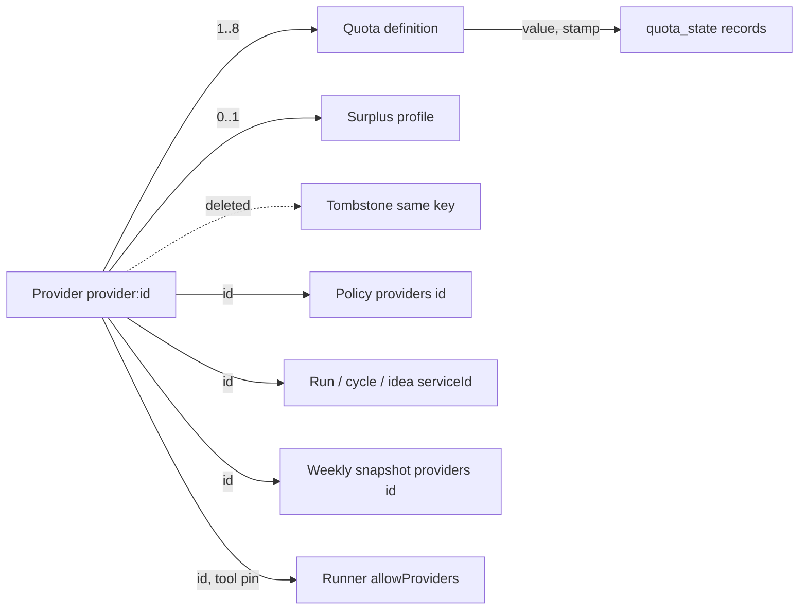

# Data Model: dynamic-providers

**Branch**: `007-dynamic-providers` | **Date**: 2026-11-04 | **Spec**: [spec.md](spec.md) | **Research**: [research.md](research.md)

Derived values (pressure, score, eligibility, days to reset, series) are never stored. Stored shapes are JSON; timestamps are ISO 8601; dates are local `YYYY-MM-DD`.

## Identifiers

| Id | Format | Source |
| --- | --- | --- |
| Provider id | `^p_[a-z2-7]{12}$` | `newId` injected, created once |
| Quota id | `^q_[a-z2-7]{8}$`, unique within its provider | created once |
| Legacy service id | one of `claude`, `chatgpt`, `copilot`, `openrouter`, `kilocode` | only found in records written by features 001 to 006; read-only, display only |

`isProviderId(id)` is the regex above. A record id that matches neither a provider id nor a legacy id is invalid.

## Provider (stored as the payload of `provider:{providerId}`)

| Field | Type | Rules |
| --- | --- | --- |
| `schemaVersion` | `1` | |
| `id` | provider id | equals the logical key suffix |
| `status` | `"active"` | |
| `name` | string | 1 to 60 chars trimmed; unique among active providers after NFC, trim, case fold |
| `cost` | `{amount, currency}` or `null` | amount ≥ 0; currency 1 to 3 chars |
| `color` | `#rrggbb` or `null` | |
| `flags` | string[] | ≤ 8 items of ≤ 30 chars; descriptive only, never used by routing |
| `note` | string | ≤ 500 chars |
| `schedule` | Schedule | see below |
| `quotas` | Quota[] | 1 to 8 items; order is display order |
| `fits` | `{ [taskId]: "strong" | "acceptable" | "weak" | "none" }` | keys ⊆ the fixed task ids; a missing key means `none` |
| `surplus` | SurplusProfile or `null` | see below |
| `createdAt`, `updatedAt` | ISO | |

### Schedule

`{ type: "weekly" | "monthly" | "custom" | "none", cycleDays: number | null }`. `weekly` → 7, `monthly` → 30, `custom` → integer 1 to 366, `none` → `null`. The recorded last reset date is not part of the definition; it stays a quota-state value (below).

### Quota (definition)

| Field | Type | Rules |
| --- | --- | --- |
| `id` | quota id | |
| `label` | string | 1 to 40 chars |
| `type` | `"consumed_pct"` \| `"remaining_pct"` \| `"currency"` | changing it requires a new value in the same edit |
| `currency` | string or `null` | required for `currency` (1 to 3 chars), else `null` |
| `lowBalance` | number or `null` | `currency` only; > 0; default 5 |
| `gates` | task id[] or `null` | `null` = all tasks; an empty array is invalid |
| `subnote` | string or `null` | ≤ 60 chars |

The current value is **not** in the definition (research D4).

### SurplusProfile

`{ tool: "claude" | "codex", weeklyQuotaId, sessionQuotaId }`. Eligible only when `surplusProblems(provider)` is empty: supported tool, `schedule.type === "weekly"`, both ids name existing quotas of type `consumed_pct` or `remaining_pct`, and the two ids differ.

### Removed provider reference (tombstone, same record)

`{ schemaVersion: 1, id, status: "removed", name, removedAt }`. Replaces the definition on deletion with a versioned `PUT`. `name` is the name at deletion. It is the only thing that survives of the definition.

### Catalogue order (`catalogue-order`)

`{ schemaVersion: 1, ids: providerId[], updatedAt }`. Ids absent from `ids` sort after the listed ones by the shared tail of the tie-break (name, id). Display order never feeds a rule.

## Quota state (unchanged mechanism, new ids)

`state[providerId] = { [quotaId]: number, ["__ts_" + quotaId]: ISO | null, "__last_reset_date": "YYYY-MM-DD" | null }`, persisted at `kairos-ai-quota-router:state` and synced as `quota_state` records `{providerId}:{quotaId}`, `{providerId}:__ts_{quotaId}`, `{providerId}:__last_reset_date`. `buildDefaultState()` returns `{}`; `addProvider` writes entered values and `now` stamps (FR-039). Entries for legacy ids stay in the object, unread and unmodified.

## Local catalogue storage

`localStorage['kairos:providers']` = `{ schemaVersion: 1, providers: { [id]: Provider | Tombstone }, order: id[] }`, plus the dirty set of the generic record-sync core. Tombstones are kept so history can name removed providers offline.

## Surplus policy v2 (`surplus-policy`, `kairos:surplus:policy`)

```
{ schemaVersion: 2,
  providers: { [providerId]: { surplusEnabled, reservePct, windowDays, autoRunEnabled, disclosuresAckAt } },
  protectedHours, costPct, thresholds, projectsBaseFolder,
  legacy?: { ...the v1 "services" object, verbatim, never read }
}
```

Per-provider entries follow today's validation rules unchanged. Entries are created when the user first turns surplus on; absent means all off. Keys must be provider ids; an entry whose provider is removed has no effect and is pruned at deletion.

## Surplus records (stored shape unchanged, additions optional)

| Record | Change |
| --- | --- |
| `idea:{id}` | `serviceId` now holds a provider id (or a legacy id on old records); no new field |
| `run:{id}` | `serviceId` provider or legacy id; **new optional `providerName`** (string, ≤ 60 chars: the name when the run started); `cycleKey` `{providerId}:{date}` |
| `cycle:{providerId}:{resetDate}` | key accepts provider or legacy ids; **new optional `providerName`** (string, ≤ 60 chars) |
| `surplus-policy`, `surplus-control`, `runner-lease` | policy v2 above; others unchanged |

Validators accept legacy ids on read so old records open (FR-036) and reject strings that are neither id kind. Writers only produce provider ids.

## Weekly snapshot v2

```
{ schemaVersion: 2, workspaceId, weekKey, weekStartDate, weekEndDate, capturedAt,
  providers: { [providerId]: { providerId, name, captured: {color, note, flags}, lastResetDate,
                               removedAt?: ISO,
                               quotas: { [quotaId]: { quotaId, label, type, value, currency, consumedPct, subnote } } } },
  services?: { ...v1 section, verbatim }   // legacy entries of the same week
}
```

One snapshot per workspace and week is kept (`workspaceId`, `weekKey`). When two snapshots of the same week meet (local and synced), they are merged by union on provider id, never replaced: an entry with `removedAt` wins, otherwise the later `capturedAt`; the legacy `services` section is kept verbatim. Sync key `weekly-history:{weekKey}` unchanged. Completed weeks are immutable; the current week is rebuilt on change, keeping entries of removed providers.

## Runner `config.json` v2

`schemaVersion: 2`, `allowProviders: [{ providerId, tool, name, allowedAt }]` replaces `allowServices`; a v1 `allowServices` is moved to `legacyAllowServices` untouched and ignored. Local only, never synced.

## Relationships



## State transitions

| Action | Catalogue | State | Policy | Other |
| --- | --- | --- | --- | --- |
| Add | new `provider:{id}`, id appended to order | values and stamps written | none (all off) | snapshot refreshed |
| Edit | `provider:{id}` rewritten (versioned PUT) | type change: new value written | entry kept; inactive if no longer eligible | history of completed weeks untouched |
| Duplicate | new provider, new ids for provider and quotas, name `"X (copy)"` made unique, `surplus` copied without policy | values copied with `now` stamps, reset date copied | none (off) | no history, no runner allowance |
| Delete | `provider:{id}` becomes tombstone; removed from order | entries left, unread | entry pruned | run in progress is stopped (D14); history keeps entries marked removed |
| Reorder | `catalogue-order` rewritten | | | |
| Restore backup | whole DB replaced; local device converges by full pull | | | |

## Validation rules summary

All FR-002/005/006/007 rules are enforced by the reducers (research D15) and re-checked by `validateProviderRecord` on every record read from the store; an invalid record is never applied and is listed with its errors, as the surplus engine does for its own records.
