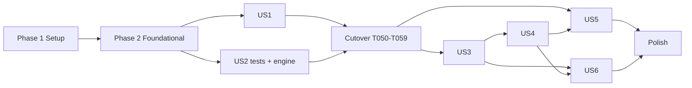

# Tasks: dynamic-providers

**Input**: Design documents from `specs/007-dynamic-providers/`
**Prerequisites**: plan.md, spec.md, research.md (D1 to D20), data-model.md, contracts/shared-records.md, contracts/routing-rules.md, contracts/runner-allowance.md, quickstart.md

**Tests**: Included. Constitution Principle III and the spec's Verification Plan require a failing-first test for every rule, guardrail and state transition, and a before/after scenario for the routing change. Pure logic is tested with `node:test` in plain Node: inject `now` and `newId`, never read the real clock, `localStorage` or the network; tests that depend on the day set `process.env.TZ` and restore it. UI-only behaviour is verified through the manual steps of `quickstart.md`.

**Organization**: Grouped by user story. **US1 and US2 are both P1 and ship together as the MVP**: the screen cannot show declared providers and the old recommendation at once, so the switch-over of the app to the catalogue is the last block of Phase 4 ("Cutover"), after which the US1 and US2 walkthroughs of `quickstart.md` section 2 are run. Until the Cutover the app keeps running on the old fixed list. Every commit on the branch leaves `npm run lint && npm test` green: a failing-first test is committed together with the implementation that makes it pass, or is skipped explicitly with a reason and the task that enables it (T045). The old `src/data/services.js` is deleted only in the last phase, once nothing imports it.

## Constitution alignment

Kairos Constitution 1.0.0, amended to 1.1.0 by T005 (executed in Phase 1, before any code that contradicts the old Product Constraints).

| Principle / gate | Where the tasks enforce it |
| --- | --- |
| I. User-Value Routing First | Every story maps to a routing, quota-visibility or decision-speed benefit (spec "Constitution Alignment"); no task adds work without one |
| II. Deterministic Rules Before Complexity | Total, order-independent ordering (T013 to T014, T039, T046); versioned rules (T036, T090); no heuristic or model logic |
| III. Verifiable Changes | Failing-first tests in every story; before/after reference scenarios with a documented intended-differences table (T042, T043); guardrail tests before runner code (T102, T103); evidence in `verification.md` |
| IV. Explainable Recommendations | Reasons and exclusion causes tested (T037, T038); surplus names its tie-break (T088, T094) |
| V. Minimal dependency, privacy by default | No runtime dependency added (T123 states it); definitions local by default, shared only in shared mode (T070 to T076); nothing about a provider is sent to an AI provider (T117 documents it) |
| Product Constraints | Amended by T005; offline core kept (T070 includes the no-network case) |
| Quality gates | Alignment checks in spec, plan and this file; PR documents behaviour change, evidence and dependency statement (T123); docs updated in the same change (T117); before/after scenario for the routing change (T043) |

## Format: `[ID] [P?] [Story] Description`

- **[P]**: can run in parallel (different files, no dependency on an unfinished task)
- **[Story]**: US1 to US6, mapping to the user stories of `spec.md`
- Paths are relative to the repository root. Single-file runs: `node --test <file>`.

## Conventions used in every task

- Provider id `^p_[a-z2-7]{12}$`, quota id `^q_[a-z2-7]{8}$` (research D1). Test fixtures use the constants exported by `src/providers/fixtures/sampleProviders.js` (T004), never literals.
- Persisted field names stay (`serviceId` on ideas, runs, cycles) and hold a provider id (research D11).
- No provider name or id literal in `src/providers`, `src/routing`, `src/surplus`, `runner` outside tests, `fixtures/` and `src/providers/legacyProviders.js` (guard test T045, enabled by T110).

---

## Phase 1: Setup

**Purpose**: Task list module, lint scope, test fixtures that capture the current stored shapes, and the constitution amendment, all before anything changes in behaviour.

- [X] T001 [P] Create `src/data/tasks.js` exporting `TASKS` (the five tasks, copied verbatim from `src/data/services.js`) and make `src/data/services.js` re-export `TASKS` from it (temporary; `services.js` is deleted in T120). Run `node --test src/` to confirm nothing changes
- [X] T002 [P] Extend `eslint.config.js` so `src/providers/**/*.js`, `src/routing/**/*.js` and `src/sync/**/*.js` lint under the same pure-module block as `src/surplus/**/*.js` (Node ES modules, no browser globals), keeping the rule that unused variables must be prefixed `_`; run `npm run lint`
- [X] T003 [P] Capture current-build stored shapes as static literals in `src/providers/fixtures/legacyData.js`: generate them once with a throwaway script run against the unmodified code (scratchpad, not committed) from `buildDefaultState()`, `defaultPolicy()`, `createWeeklySnapshot()` over the five fixed services, and hand-written minimal examples of a run record, a cycle record, a launched idea and a runner `config.json` v1 with `allowServices: ['claude']`. Export `LEGACY_STATE`, `LEGACY_POLICY_V1`, `LEGACY_SNAPSHOT_V1`, `LEGACY_RUN`, `LEGACY_CYCLE`, `LEGACY_IDEA_LAUNCHED`, `LEGACY_RUNNER_CONFIG_V1` (research risk R2)
- [X] T004 [P] Create `src/providers/fixtures/sampleProviders.js` (test only): exports valid provider-id/quota-id constants, `sampleProvider(overrides)` builders returning stored-shape providers (weekly subscription with two percentage quotas and an eligible `claude`-tool surplus profile, monthly subscription with one quota, pay-as-you-go currency balance) and `sampleServices()` returning their runtime form as plain literals written by hand from the shape in `data-model.md` (it must not call `toRuntimeService`, which does not exist yet; T017 asserts the two agree). It replaces `SERVICES` as sample data in existing tests (T056, T096, T109)
- [X] T005 [P] Amend `.specify/memory/constitution.md` to **1.1.0** (research D19) before any code that contradicts Product Constraints 1.0.0: replace the first two Product Constraints with the generalised scope (user-declared providers, no shipped list) and per-quota explicit modes, update the Sync Impact Report (version change, modified sections, "Last Amended"), keep principles I to V unchanged, and check `.specify/templates/*` (plan, spec, tasks templates) for the old wording and record the result as migration notes in the report (Governance: amendments include migration notes for active templates). The amendment is proposed through this feature's pull request (T123)

---

## Phase 2: Foundational (blocking prerequisites)

**Purpose**: Behaviour-preserving sync-core extraction, then the pure provider modules every story uses. No user-visible change yet.

**CRITICAL**: No user story work starts before this phase is complete.

### Generic record-sync core (research D3, risk R1)

- [X] T006 Baseline: run `node --test src/surplus/engine.test.js src/surplus/store.test.js src/surplus/storage.test.js` and record that they pass; these tests must stay **unchanged and green** through T007 and T008
- [X] T007 Extract the generic part of `src/surplus/engine.js` into `src/sync/recordSync.js`: dirty-set persistence (key injected), debounced flush, serialised writes and pulls, `pushOne` with create-or-update, 409 resolution via an injected `onConflict(key, local, serverRecord)`, incremental pull with cursor, periodic full pull with deletion detection, status snapshot and subscription. The core is parameterised by `{ storage, api, now, newId, debounceMs, setTimer, clearTimer, dirtyStorageKey, parseKey, applyRecords, serialize }` and holds no surplus vocabulary. Add `src/sync/recordSync.test.js` with a fake API covering flush ordering, 409 callback, full-pull deletion and storage failure (depends on T006)
- [X] T008 Rewire `src/surplus/engine.js` onto `src/sync/recordSync.js` with no behaviour change (same exports, same dirty key `kairos:surplus:dirty`, same debounce); the T006 tests pass untouched (depends on T007)

### Identity, schema, tie-break

- [X] T009 [P] Write failing tests `src/providers/ids.test.js`: `newProviderId(random)` matches `^p_[a-z2-7]{12}$`, `newQuotaId(random)` matches `^q_[a-z2-7]{8}$`, deterministic with an injected random source, `isProviderId`/`isQuotaId` accept and reject strings, `isLegacyServiceId` true only for `claude`, `chatgpt`, `copilot`, `openrouter`, `kilocode`, and no generated id ever equals a legacy id
- [X] T010 Implement `src/providers/ids.js` (T009): exports `newProviderId`, `newQuotaId`, `isProviderId`, `isQuotaId`, `LEGACY_SERVICE_IDS` (frozen), `isLegacyServiceId`, `isKnownServiceRef(id)` = provider id or legacy id; pure, random source injected
- [X] T011 [P] Write failing tests `src/providers/schema.test.js` for `validateProvider(input, { existingNames, taskIds })`, one test per rule, each error `{path, message}` with a path such as `name` or `quotas[1].value`: `name` 1 to 60 chars trimmed and unique among active providers after NFC, trim and case fold; `cost` null or `{amount ≥ 0, currency 1 to 3 chars}`; `color` `#rrggbb` or null; `flags` ≤ 8 items of ≤ 30 chars; `note` ≤ 500 chars; `schedule` `{type: weekly|monthly|custom|none, cycleDays}` with weekly 7, monthly 30, custom integer 1 to 366, none null; `quotas` 1 to 8 items, `label` 1 to 40 chars, `type` one of `consumed_pct|remaining_pct|currency`, `currency` required 1 to 3 chars for currency else null, `lowBalance` null or > 0 (currency only), `gates` null or a non-empty list of known task ids, `subnote` ≤ 60 chars; values: percentages 0 to 100, currency ≥ 0, finite numbers only; `fits` keys ⊆ task ids with values `strong|acceptable|weak|none`
- [X] T012 Implement `src/providers/schema.js` (T011): constants (`FIT_LEVELS`, `QUOTA_TYPES`, `SCHEDULE_TYPES`, `LIMITS`), `validateProvider`, `validateQuotaValue(quota, value)`, and `PROVIDER_SCHEMA_VERSION = 1`. Pure, no mutation, returns `{ ok, errors }`
- [X] T013 [P] Write failing tests `src/providers/tiebreak.test.js`: `normalizeName` applies NFC, trim and case fold (`"Café "` equals `"CAFÉ"`, composed equals decomposed), `compareByName(a, b)` orders by normalised name then by id, is antisymmetric and transitive over a shuffled set of 12 providers, and never returns 0 for two providers with different ids
- [X] T014 Implement `src/providers/tiebreak.js` (T013): `normalizeName`, `compareByName`. It is the shared order-independent tail used by routing (T046) and surplus (T094)
- [X] T015 [P] Write failing tests `src/providers/surplusProfile.test.js`: `SUPPORTED_TOOLS` is `['claude','codex']`; `surplusProblems(provider)` returns user-facing strings for each unmet condition (no supported tool; schedule not weekly; weekly quota not designated or missing or not a percentage quota; session quota same; the two designations equal) and `[]` when eligible; a provider with `surplus: null` returns the single problem "no terminal tool declared"
- [X] T016 Implement `src/providers/surplusProfile.js` (T015)
- [X] T017 [P] Write failing tests `src/providers/runtime.test.js` for `toRuntimeService(provider)` and `toRuntimeServices(catalogue)`: schedule maps weekly → `resetCycleDays 7`, monthly → 30, custom → the number, none → `null` (and `resetType` accordingly); quotas carry `id,label,type,currency,lowBalance,gates,subnote`; `surplus` present only when `surplusProblems` is empty; tombstones are excluded; output order follows `catalogue.order` then `compareByName`; the result is accepted unchanged by `evaluateSurplus` and `createWeeklySnapshot`; `toRuntimeService(sampleProvider())` deep-equals the matching `sampleServices()` entry (keeps the T004 literals honest)
- [X] T018 Implement `src/providers/runtime.js` (T017): `toRuntimeService`, `toRuntimeServices`, `activeProviders(catalogue)`, `removedProviders(catalogue)`

### Records, storage, names, pressure

- [X] T019 [P] Write failing tests `src/providers/records.test.js`: `providerKey(id)` → `provider:{id}` (rejects non-provider ids), `ORDER_KEY = 'catalogue-order'`, `parseCatalogueKey` returns `{kind:'provider',id}`/`{kind:'order'}`/`null`; `validateProviderRecord` accepts a valid definition and a tombstone `{schemaVersion:1,id,status:'removed',name,removedAt}`, rejects an id differing from the key and every schema violation; `validateOrderPayload`; `applyCatalogueRecords(catalogue, items)` applies valid records, ignores other namespaces and other record types, skips older versions, never applies an invalid record (listed in `invalid` with errors), lets a tombstone win over any older or equal-version definition, and never resurrects a removed provider from a stale active record; `nameConflicts(catalogue)` returns the ids of active providers whose normalised name equals that of an earlier-created active provider (earlier `createdAt` wins, then the smaller id), so duplicates created offline on two devices are detectable after sync (FR-002)
- [X] T020 Implement `src/providers/records.js` (T019): keys, parsers, validators, `applyCatalogueRecords`, `nameConflicts`, `emptyCatalogue()` = `{schemaVersion:1, providers:{}, order:[], recordIndex:{}, invalid:[]}`
- [X] T021 [P] Write failing tests `src/providers/storage.test.js` with an injected storage object: `loadCatalogue` on empty or corrupt or foreign data returns `emptyCatalogue()` and never throws (FR-001: nothing is pre-filled), `saveCatalogue` round-trips providers, tombstones and order, records the write failure instead of throwing, and does not touch the keys `kairos-ai-quota-router:state` or `kairos:weekly-history`
- [X] T022 Implement `src/providers/storage.js` (T021): storage key `kairos:providers`
- [X] T023 [P] Write failing tests `src/providers/names.test.js` for `resolveProviderName(id, { catalogue, capturedName })` → `{ name, removed: boolean, source }` in order: live provider; `capturedName`; tombstone name; legacy table (the five former ids → their former display names, `removed: true`, source `legacy`); otherwise the id with `removed: true` and source `unknown`
- [X] T024 Implement `src/providers/names.js` and `src/providers/legacyProviders.js` (T023): the display-only table of the five former ids and names; this file and `fixtures/` are the only non-test places allowed to contain those literals
- [X] T025 [P] Write failing tests `src/utils.currency.test.js`: with no `lowBalance` the currency bands equal the current table exactly (≤ 0 → 100, < 2 → 85, < 5 → 60, otherwise 20); with `lowBalance: 20` the bands are < 8 → 85, < 20 → 60; percentage types are unchanged; `getStatusBadge` and bar colours unchanged; `getServicePressure` ignores a quota whose stored value is `undefined` or `null` (unread) instead of returning NaN, and is 0 when every quota is unread
- [X] T026 Implement in `src/utils.js` (T025) `getConsumedPct` currency bands from `quota.lowBalance ?? 5` (≤ 0 → 100; < 0.4 × lowBalance → 85; < lowBalance → 60; else 20), and make `getServicePressure` skip unread quotas, leaving the signatures and all other helpers unchanged; run `node --test src/` to confirm existing suites stay green (research D6)

**Checkpoint**: `npm test` green; no UI change; the app still runs on `SERVICES`.

---

## Phase 3: User Story 1 - Build my own provider list from scratch (Priority: P1)

**Goal**: Declare providers from an empty start (name, quotas, reset schedule, cost, colour, flags, note), validated, persisted locally, with quota readings recorded as entered.

**Independent test**: From a profile with no stored data, add three providers of different kinds, reload, and see exactly those three with their values; invalid input is refused next to the field (`quickstart.md` section 2 steps 1 to 3, run after the Cutover).

### Tests for User Story 1

- [X] T027 [P] [US1] Write failing tests `src/providers/catalogue.add.test.js` for `addProvider({ catalogue, state, input, now, newId })` returning `{ ok:true, catalogue, state, effects }`: creates the provider with `createdAt`/`updatedAt = now`, generated provider and quota ids, `status:'active'`, appends the id to `order`; writes each entered quota value and its stamp `__ts_{quotaId} = now.toISOString()` (FR-039), and `__last_reset_date` null; `effects.stateWrites` lists the `{providerId}:{quotaId}`, stamp and reset-date keys to persist; leaves entries of former ids already in `state` untouched (use `LEGACY_STATE`); two providers get distinct ids
- [X] T028 [P] [US1] Write failing refusal tests in the same file family `src/providers/catalogue.add.refusals.test.js`: empty name; name equal to an existing one ignoring case and surrounding spaces (`"claude"` vs `" Claude "`); no quota; 9 quotas; percentage value 140, -1, `NaN`, `"abc"`; negative currency balance; `custom` cycle 0 or 400; negative cost; invalid colour; each refusal returns `{ ok:false, errors:[{path,message}] }` with the path of the offending field and returns the **same** `catalogue` and `state` references (FR-021: nothing half-created)
- [X] T029 [P] [US1] Write failing tests `src/providers/catalogue.persistence.test.js`: add three providers (weekly with two quotas, monthly with one, pay-as-you-go currency), `saveCatalogue`, `loadCatalogue` on a fresh storage object returns deep-equal providers and order (SC-006); a catalogue loaded from empty storage contains no provider and `toRuntimeServices` is `[]` (FR-001); `LEGACY_STATE` loaded alongside shows zero providers; `commitCreation({ stateStorage, catalogueStorage, result })` writes the quota-state patch first and the definition second, and with a `catalogueStorage` that throws on write the reloaded catalogue has **no** provider while only inert quota-state values were written (FR-021)

### Implementation for User Story 1

- [X] T030 [US1] Implement `addProvider` in `src/providers/catalogue.js` (T027, T028, T029): validate through `validateProvider`, build the stored shape of `data-model.md`, create ids with the injected `newId`, compute the state writes, return an unchanged `catalogue`/`state` on refusal. Add `src/providers/commit.js` with `commitCreation` (state patch first, definition second, per T029). Add pure `applyProviderStateEffects(prevState, effects)` to `src/stateTransitions.js` so the quota hooks can apply `effects.stateWrites` in one commit
- [X] T031 [US1] Create `src/hooks/useCatalogue.js` (local-first; shared mode is added in T076): loads `kairos:providers` once, exposes `providers` (stored), `runtimeProviders` (`toRuntimeServices`), `order`, `addProvider(input)` returning the reducer result, and saves the catalogue after every successful action. Creation is persisted through `commitCreation` (T030): quota-state effects first, then the definition, so an interrupted save leaves inert values rather than a half-defined provider (FR-021)
- [X] T032 [P] [US1] Create `src/components/EmptyState.jsx` and `EmptyState.module.css`: explanatory empty state with an "Add your first provider" button, shown when there is no provider (US1-1)
- [X] T033 [P] [US1] Create `src/components/ProviderForm.jsx` and `ProviderForm.module.css` (create mode): name, optional cost and currency, colour, flags, note, reset schedule (weekly, monthly, custom days, none), repeatable quota rows (label, type, current value, currency symbol and low-balance level for currency, gated tasks defaulting to all), and a fit grid over the five tasks with the visible default "Not set: treated as not suitable". The form holds no rules: it submits to a handler and renders `errors[path]` next to the field it names; cancel discards the draft without calling the handler
- [X] T034 [P] [US1] Create `src/components/ProviderManager.jsx` and `ProviderManager.module.css`: the "Add provider" entry point that opens `ProviderForm`, and the list region the later stories extend (edit, duplicate, reorder, delete)
- [X] T035 [US1] Adapt `src/components/ServiceCard.jsx` to a provider: no cost line when `cost` is null, a reset label for weekly, monthly, custom (`every N days`) and none, no "overdue" for none, flags and note shown when present; a quota with no stored value shows "No reading yet" (never `undefined` or NaN) and is left out of the pressure bar; `getResetInfo` is exercised for monthly (30 days) and custom cycles (FR-008); the existing quota edit, reset-date edit and "still current" confirmation (FR-039) work unchanged on the provider's quota ids

**Checkpoint**: US1 logic and components exist and are unit-tested; they are wired into `App.jsx` in the Cutover (T057).

---

## Phase 4: User Story 2 - Get recommendations based on my own providers (Priority: P1)

**Goal**: A deterministic, explained recommendation computed only from declared fit, gating quota state and reset timing, replacing the five hard-coded rules; then switch the whole app to the catalogue.

**Independent test**: Declare two providers with fits for a task; check the primary, reason and alternative; change a quota; add a third; remove the primary; shuffle creation order and get identical results (`quickstart.md` section 2 step 4).

### Tests for User Story 2

- [X] T036 [P] [US2] Create `src/routing/constants.js` exporting `ROUTING_RULESET_VERSION = 2`, `FIT_SCORE = {strong:3, acceptable:2, weak:1, none:0}`, `BAND_WARN = 60`, `BAND_CRIT = 85`, `BUCKET_WIDTH = 15`, `MAX_ALTERNATIVES = 3`, `RESET_NOTE_DAYS = 2` (research D5, D7, D8)
- [X] T037 [P] [US2] Write failing tests `src/routing/engine.test.js`: classification (fit none or undeclared → `not_suitable` with the visible default; a gating quota at 100 % consumed or balance ≤ 0 → `blocked` naming the quota; a gating quota without a reading → `unread`); a quota that does **not** gate the task never blocks it (quota gating `coding_hard` exhausted, task `daily_chat` still eligible); pressure is the maximum over gating quotas using all three quota types; score table (strong at 70 % = 2, acceptable at 20 % = 2, weak at 90 % = −1); a strong-fit provider at 70 % loses to an acceptable one at 20 % unless reset favours it; exact `reason` content (fit, pressure with the quota label, days to reset, decisive criterion, reset note for due today / overdue / ≤ 2 days); alternatives capped at 3 in rank order; `excluded` lists every other provider with its cause
- [X] T038 [P] [US2] Write failing tests `src/routing/engine.nopick.test.js`: no provider → reason says to add one; providers exist but none suited → says so; all suited providers blocked → says so and, when reset dates are known, names the soonest reset; exactly one eligible provider → primary and no alternatives; exactly one provider and blocked → nothing available (spec edge cases, FR-016)
- [X] T039 [P] [US2] Write failing tests `src/routing/engine.determinism.test.js`: 200 seeded permutations of six providers (names such as `Alpha`, `alpine`, `Beta`, so name ordering is exercised) yield deep-equal `Recommendation` objects (FR-014, SC-004); repeated calls are deep-equal; 20 providers of 4 quotas each complete and give the same result when shuffled (FR-009, SC-009); adding a provider or removing the primary changes the result as the rules dictate (FR-017); the `tieBreak.criterion` names the first differing criterion among `score`, `pressure_bucket`, `reset`, `pressure`, `fit`, `name`
- [X] T040 [P] [US2] Write failing tests `src/routing/engine.reset.test.js` with `TZ` set: two equally suited providers with comparable pressure and different reset days → the sooner reset is primary and the reason says so (FR-015); pressures 14 and 16 fall in different buckets (documented difference D7); `overdue`, `unset`, `invalid` and `none` sort after known resets; a due or overdue reset is noted in the reason; an overdue provider is never preferred as the "sooner reset"
- [X] T041 [P] [US2] Write failing tests `src/routing/day-basis.test.js` (FR-038): with `TZ=Pacific/Auckland` and `America/Los_Angeles`, one `now` at 23:59 and 00:01 local gives the same `daysRemaining` from `getResetSignals`, `recommend` and `evaluateSurplus` for the same provider
- [X] T042 [P] [US2] Create the test-only before/after fixtures `src/routing/fixtures/legacyProviders.js` (the former five providers declared as a user would, via the stored shape: fits per task chosen to mirror the former rules, gates per quota, `lowBalance` 5, schedules weekly/weekly/monthly/none/none) and `src/routing/fixtures/legacyRules.js` (verbatim copy of `src/data/rules.js` with its imports adapted); the header comment states they are reference data for T043 and are not shipped
- [X] T043 [US2] Write `src/routing/routing.reference.test.js` (constitution: before/after for routing changes): over a grid of states (Claude weekly 0/30/60/70/85/100 × slot 40/100, Copilot monthly 20/60/90, ChatGPT remaining 75/10/0, balances 0.5/3/8, reset days 0/1/2/5/overdue/unset) and the five tasks, run `legacyRules.RULES[task]` and `recommend` on the equivalent declared providers; assert the same primary wherever the rules agree and list every divergence in an exported `INTENDED_DIFFERENCES` table with its cause (pressure buckets D7, dropped `daily_chat` redirect and USD > 1 cut-off D8, free-text advice); a divergence not in the table fails the test (depends on T042)
- [X] T044 [P] [US2] Write failing tests `src/providers/summary.test.js` for `summarizeProviders(runtimeProviders, state)`: monthly cost totals grouped **per currency** (never summing across currencies), count of providers under pressure using `getConsumedPct`, unread quotas ignored, provider with no cost contributes nothing, empty list gives zero totals
- [X] T045 [P] [US2] Write `src/routing/no-provider-literals.test.js` (FR-011, research D18). It reads every non-test source file under `src/providers`, `src/routing`, `src/surplus` and `runner` (excluding `*.test.js`, `*.testkit.js`, any `fixtures/` folder and `src/providers/legacyProviders.js`) and fails on: (a) the case-insensitive words `chatgpt`, `copilot`, `openrouter`, `kilocode` anywhere, except in the explicit allow-list entry `runner/preflight.js` (the codex login-status text "Logged in using ChatGPT" and its messages); (b) the words `claude` and `codex` anywhere except the allow-listed tool files `src/providers/surplusProfile.js`, `src/surplus/constants.js` (only if it still lists tools), `runner/adapters/claude.js`, `runner/adapters/codex.js`, `runner/preflight.js`, `runner/config.js` (tool names and default tool paths) and `runner/loop.js` (adapter table); each allow-list entry names the file and the reason. Because it fails on today's `src/surplus` and `runner` sources, **commit it with `{ skip: 'enabled by T110' }`** and remove the skip in T110

### Implementation for User Story 2

- [X] T046 [US2] Implement `src/routing/engine.js` (T037 to T041): `recommend({ task, providers, state, now })` per `contracts/routing-rules.md`: classification, pressure over gating quotas via `getConsumedPct`, score = fit − band penalty, total order (score desc; pressure bucket asc; days to reset asc among `countdown`/`due`, others last; pressure asc; fit desc; `compareByName`), `primary`, `alternatives`, `excluded`, `tieBreak`, and a `reason` built only from those facts plus the reset note. No provider literal, no clock read, no mutation
- [X] T047 [US2] Implement `src/providers/summary.js` (T044)
- [X] T048 [US2] Rewrite `src/components/RecoBox.jsx` for providers: props `{ task, providers, state, now }`, calls `recommend`, shows primary with reason and decisive criterion, alternatives, a collapsible list of excluded providers with their causes, and the three distinct empty messages; remove its `SERVICES` and `RULES` imports and its implicit `new Date()`
- [X] T049 [P] [US2] Update `src/components/TaskPicker.jsx` to import `TASKS` from `src/data/tasks.js`; update `src/components/SummaryBar.jsx` to take `providers` and `now` and render `summarizeProviders` (per-currency totals), removing its `SERVICES` import

### Cutover: switch the app to the catalogue (completes US1 and US2)

- [X] T050 [US2] Change `src/stateTransitions.js`: remove the `SERVICES` default from `buildDefaultState`, `confirmQuotas` and `recordCurrentWeek` (callers pass runtime providers), `buildDefaultState(providers = [])` returns `{}` for an empty list and seeds provider quotas with `null` stamps otherwise; unknown ids in a stored state are preserved on every transition (FR-022). Update `src/stateTransitions.quota-stamps.test.js` accordingly (depends on T004)
- [X] T051 [US2] Change `src/hooks/useQuotaState.js` to take `providers` instead of `SERVICES`: load the stored state without filtering unknown keys, never write defaults for providers (values arrive through `applyProviderStateEffects`), keep persisting legacy keys byte-for-byte (FR-022)
- [X] T052 [US2] Change `src/hooks/useSharedQuotaState.js` to take `providers`: delete `buildDefaultEntries` seeding (readings are written by the creation effects), build snapshots from the runtime providers, `confirmQuotas` and `updateQuota` by provider id, and treat a quota without a stored value as unread (research D4). The weekly-history call sites keep the existing snapshot shape until T083 (snapshots written on this branch between the Cutover and T083 hold provider ids under `services` and are development data to be discarded, not migrated)
- [X] T053 [US2] Update `src/services/localExport.js` to iterate the catalogue read from `kairos:providers` instead of `SERVICES` (quota values, stamps, reset date per quota of each active provider); provider-definition records are added in T078
- [X] T054 [US2] Update `src/components/WeeklyHistoryPanel.jsx` to list the runtime providers it is given (series by provider id through the existing `deriveServiceHistorySeries`); legacy and removed series are added in T084
- [X] T055 [US2] Update `src/hooks/useSurplusStore.js`, `src/components/SurplusNotice.jsx`, `src/components/CycleSummary.jsx`, `src/components/RunReview.jsx`, `src/components/SurplusSettings.jsx` to receive providers through props instead of importing `SERVICES` (and `SUPPORTED_SERVICE_IDS` where it only filtered services), with the minimum change that keeps them compiling and showing "no provider available for surplus use" until US5; the rewrite of their logic is in T097
- [X] T056 [US2] Move the pure-logic tests that imported `SERVICES`/`RULES` off them: `src/utils.reco-reset.test.js` keeps its `getResetInfo` and reset-note-date assertions on `sampleServices()` and drops the rule assertions (now covered by T037 to T043), and gains `getResetInfo` cases for a 30-day (monthly) and a custom 10-day cycle (countdown, due, overdue) and for `none` (never overdue) (FR-008); `src/utils.weekly-history.test.js`, `src/stateTransitions.weekly-history.test.js`, `src/weekly-history.integration.test.js`, `src/services/localExport.stamps.test.js`, `src/services/localExport.weekly-history.test.js` use `sampleServices()`/`sampleProviders` (depends on T004, T050)
- [X] T057 [US2] Rewrite `src/App.jsx`: obtain `now` from a new `src/hooks/useNow.js` (one value per render pass, refreshed every 60 s and on window focus with injectable timers so day counts stay right across midnight, as the surplus evaluation already refreshes every 60 s); `useCatalogue()`; quota hooks with `runtimeProviders`; render `EmptyState` when there is no provider, otherwise `ServiceCard` per provider; `ProviderManager` with the add flow (`addProvider` then `applyProviderStateEffects` in the same handler, state first then definition per T031); pass `now` to `RecoBox`, `SummaryBar`, surplus evaluation and `getResetSignals` (FR-038); remove the `SERVICES` import. Run `npm run lint && npm test && npm run build`
- [X] T058 [US2] Delete `src/data/rules.js` (replaced by `src/routing/engine.js`); confirm no import remains (`grep -rn "data/rules" src runner`) and the build passes
- [ ] T059 [US2] Run the US1 and US2 manual walkthrough (`quickstart.md` section 2 steps 1 to 4, including leaving the page open across local midnight or changing the system clock and seeing the day counts update) and record the evidence (observed behaviour per step) in `specs/007-dynamic-providers/verification.md`

**Checkpoint**: MVP. The app starts empty, providers can be declared, recommendations follow them, the old rules are gone.

---

## Phase 5: User Story 3 - Modify or delete a provider (Priority: P2)

**Goal**: Edit every attribute with immediate effect, add and remove quotas, confirm quota-type changes, delete with an informative confirmation that keeps history.

**Independent test**: Rename a provider, change cost, add and remove quotas, change the schedule, then delete it; changes show in the card, recommendation and after reload; cancelling changes nothing (`quickstart.md` section 2 steps 5 and 6).

### Tests for User Story 3

- [X] T060 [P] [US3] Write failing tests `src/providers/catalogue.update.test.js` for `updateProvider({ catalogue, state, id, patch, now })`: edits name, cost, colour, flags, note, schedule, fits, quota definitions and gates; `updatedAt = now`; the new name is checked for uniqueness excluding the provider itself; adding a quota writes its value and stamp, removing one keeps at least one (removing the last returns an error at `quotas`); changing a quota's `type` without a new `value` in the same patch is refused at `quotas[i].value` with "confirm or re-enter the value" and never reinterprets the stored number (FR-007), with a value it writes the value and a fresh stamp; changing the schedule while `__last_reset_date` is recorded returns `needsConfirmation: { kind:'schedule', lastResetDate }` and applies nothing until the patch carries `confirmSchedule: true` (optionally with a corrected `lastResetDate`); a refused patch returns the same references (FR-021); ids of providers and untouched quotas never change
- [X] T061 [P] [US3] Write failing tests `src/providers/catalogue.remove.test.js` for `removeProvider({ catalogue, state, policy, id, now })`: the stored record becomes a tombstone `{ status:'removed', name: <name at deletion>, removedAt: now }`, the id leaves `order`, `toRuntimeServices` no longer returns it, the result lists `effects.policyPrune` (its per-provider surplus entry) and `effects.stateKept: true` (quota entries stay, unread), removing an unknown or already removed id is a no-op error; recreating a provider with the same name yields a new id with no inherited state, policy, history or allowance (FR-022 edge case)
- [X] T062 [P] [US3] Write failing tests `src/providers/activeRun.test.js` for `activeRunFor(providerId, runs)` (a run with `status:'running'` and that `serviceId`) and `describeDeletion(provider, runs)` returning the lists "will be removed" (quotas, reset dates, surplus settings) and "will be kept" (weekly history, past run records shown as removed) and a `runWarning` string when a run is active (US3-4, FR-037 browser side)
- [X] T063 [P] [US3] Add to `src/routing/engine.determinism.test.js` (T039) a case proving FR-017: compute a recommendation, remove its primary through `removeProvider`, recompute from the new catalogue: the result no longer mentions the removed provider id or name in `primary`, `alternatives` or `reason`

### Implementation for User Story 3

- [X] T064 [US3] Implement `updateProvider` and `removeProvider` in `src/providers/catalogue.js` (T060, T061) and `describeDeletion`/`activeRunFor` in `src/providers/activeRun.js` (T062)
- [X] T065 [US3] Extend `src/hooks/useCatalogue.js` with `updateProvider`, `removeProvider` (applies `effects` to the quota-state hook and the surplus policy through callbacks passed by `App`) and a `cancel` that is a no-op by construction. Implement each action as a thin delegation to the pure reducer plus `commit*`, so that T076 swaps the persistence layer without touching the actions; the policy prune is wired in T099
- [X] T066 [P] [US3] Extend `src/components/ProviderForm.jsx` to edit mode: pre-filled draft, add/remove quota rows (remove disabled on the last), a type change that opens the "enter the new value" field and blocks submit until filled, a schedule change that shows the confirm/correct-reset-date step from `needsConfirmation`, Cancel leaves the stored provider untouched
- [X] T067 [P] [US3] Create `src/components/DeleteProviderDialog.jsx` and `DeleteProviderDialog.module.css`: names the provider, shows "will be removed" and "will be kept" from `describeDeletion`, shows the run warning when present, offers Cancel and an explicit Delete button; nothing is removed before the explicit confirmation (FR-004)
- [X] T068 [US3] Wire edit and delete into `src/components/ProviderManager.jsx` and `src/components/ServiceCard.jsx` (Edit and Delete buttons per card) and into `src/App.jsx` (pass `runs` from the surplus store to the dialog)
- [ ] T069 [US3] Run `quickstart.md` section 2 steps 5 and 6, append the evidence to `specs/007-dynamic-providers/verification.md`

**Checkpoint**: US3 works with the local-only catalogue.

---

## Phase 6: User Story 4 - Keep my provider list safe across devices and backups (Priority: P2)

**Goal**: Definitions behave like quota data: local-first, shared across devices with conflict handling, restored by backup, present in the local export.

**Independent test**: Two profiles on one workspace see the same list; concurrent edits report a conflict; deletion is not resurrected; backup/restore returns definitions with readings and history (`quickstart.md` section 4).

### Tests for User Story 4

- [X] T070 [P] [US4] Write failing tests `src/providers/engine.test.js` for `createCatalogueEngine` (built on `src/sync/recordSync.js`, fake API as in `src/surplus/engine.test.js`): local actions never need the network (with an API double that rejects every call, add, edit and delete still succeed locally and the engine reports `local` status; FR-025); in shared mode a created provider is `POST`ed and an edit `PUT`s with `expected_version`; edits flush after the debounce; a pull applies another device's provider and order records; two engines editing the same provider: the second save gets a 409, the engine exposes `conflicts` with the server version and does not overwrite it (US4-3, SC-007)
- [X] T071 [P] [US4] Write failing tests `src/providers/engine.tombstone.test.js`: device A deletes (tombstone `PUT`) while device B edits from a stale version → B's `PUT` conflicts, B's edit is dropped with the message "removed on another device", the provider is not resurrected (edge case); a periodic full pull that no longer lists a record applies the removal; a tombstone is never HTTP-deleted
- [X] T072 [P] [US4] Write failing tests `src/providers/engine.late.test.js` (US4-6, FR-030): readings (`quota_state`) and a snapshot mentioning provider P arrive before `provider:P`; nothing creates P; once `provider:P` arrives it appears live and its quotas show unread until readings exist; an invalid `provider:*` record is listed in `invalid` with its errors and is never applied; two active providers with the same normalised name (created offline on two devices) both stay in the catalogue and in recommendations (ordered by the tie-break), `nameConflicts` lists the later one, and nothing is renamed or deleted automatically
- [X] T073 [P] [US4] Write failing contract test `backend/tests/contract/provider-records.contract.test.js` using `backend/tests/helpers`: create `provider:{id}` and `catalogue-order` as `routing_config`, `PUT` with version, `409` on a stale version, tombstone `PUT`, `since` listing, and a backup → mutate → restore round trip returning the same `provider:*` records; assert `quota_state`, `snapshot` and surplus records in the same workspace are untouched. No backend source change is expected; if a test fails, fix the test setup, not the backend, and record it in `research.md`
- [X] T074 [P] [US4] Write failing tests `src/services/localExport.providers.test.js`: the export contains `provider:{id}` records (active and tombstones) and `catalogue-order` as `routing_config`, plus quota values, stamps, reset dates and weekly history for the active providers, and contains no surplus records (scope unchanged); legacy state entries are not exported (FR-020, US4-5)

### Implementation for User Story 4

- [X] T075 [US4] Implement `src/providers/engine.js` (T070 to T072) on `src/sync/recordSync.js`: `createCatalogueEngine({ storage, api, now, newId, ... })` with `setWorkspace`, `refresh`, action methods delegating to the pure reducers, `conflicts`, `invalid`, `nameConflicts`, status and subscription, dirty key `kairos:providers:dirty`
- [X] T076 [US4] Switch `src/hooks/useCatalogue.js` to the engine (external-store subscription like `useSurplusStore`), taking `workspaceId`; local-only mode behaves exactly as before
- [X] T077 [P] [US4] Add to `src/components/ProviderManager.jsx` a conflict notice listing providers changed on another device (with Keep theirs / Reapply mine) an "invalid shared provider record" list (mirroring how `IdeaQueue` shows invalid records), and a "name used twice" notice for each id in `nameConflicts` that opens the edit form on the name field
- [X] T078 [US4] Extend `src/services/localExport.js` to emit provider and order records (T074); update `src/components/MigrationPanel.jsx` copy if it lists what is exported
- [X] T079 [US4] Extend `backend/tests/integration/us3-backup-restore.test.js` with provider records in the snapshot/restore scenario (definitions, readings and weekly snapshot restored together, US4-4, SC-008)
- [ ] T080 [US4] Run `quickstart.md` section 4 with two browser profiles and append the evidence to `specs/007-dynamic-providers/verification.md`

**Checkpoint**: US4 works across devices and restores.

---

## Phase 7: User Story 5 - Weekly history and surplus follow my providers (Priority: P2)

**Goal**: Weekly history by provider identity (rename, edit, delete, late creation), surplus per provider with explicit eligibility and an order-independent tie-break, and a runner that learns providers from the store but is only authorised by its own pinned allowance.

**Independent test**: `quickstart.md` sections 3 and 5.

### Weekly history (FR-026 to FR-030, SC-010)

- [X] T081 [P] [US5] Write failing tests `src/utils.weekly-history.providers.test.js`: `createWeeklySnapshot({ workspaceId, state, providers, previous, now })` writes `schemaVersion: 2` with a `providers` map `{providerId, name, captured{color,note,flags}, lastResetDate, quotas{quotaId,label,type,value,currency,consumedPct,subnote}}`; a quota with no value yet is left out of the snapshot (never recorded as `undefined`) and appears once its first reading exists; with zero providers `recordWeeklySnapshot` returns the same history reference (nothing recorded); a v1 `LEGACY_SNAPSHOT_V1` for the same week is carried verbatim as `services` inside the v2 snapshot (one snapshot per workspace and week); an entry already present for a provider that is no longer live (removed) is kept with `removedAt` in the **current** week; completed weeks are never rewritten by any call; retention keeps 52 completed weeks and the current one; `snapshotsEquivalent` still ignores only `capturedAt`; `mergeWeekSnapshots(local, remote)` merges two snapshots of the same workspace and week by union on provider id (an entry carrying `removedAt` wins over one without; otherwise the later `capturedAt`; the legacy `services` section is kept verbatim from whichever side has it), and is tested with: a stale remote v1 snapshot arriving after local v2 entries, a remote snapshot lacking a provider deleted locally this week (the removed entry is kept), a remote snapshot with a provider unknown locally (kept from its own data, no catalogue change)
- [X] T082 [P] [US5] Write failing tests `src/utils.history-series.test.js` for `deriveProviderHistorySeries({ history, providerId, catalogue, fromWeekKey, toWeekKey })`: a rename continues one series under the current name; weeks before the provider existed give `missing_service` with the message "No history recorded for this provider this week" and never zero values; a removed provider's weeks are labelled with the name captured and `removed: true`, including the current week; a quota removed or retyped later keeps earlier entries with the type each was captured with; a legacy id (from the `services` section) returns a read-only series with `removed: true` and the legacy table name; a snapshot mentioning an unknown provider yields a series from its own data without any catalogue change (FR-030)
- [X] T083 [US5] Implement snapshot v2 and `deriveProviderHistorySeries` in `src/utils.js` (T081, T082), keeping `getLocalWeekKey`, retention and `adoptLocalSnapshots` behaviour; update `src/stateTransitions.js` `recordCurrentWeek` to pass the previous same-week snapshot and runtime providers; `upsertCurrentWeekSnapshot` and `applySnapshotRecord` merge through `mergeWeekSnapshots` for any week both sides hold instead of replacing it (so FR-028 holds across devices), and stay free of any effect on live state or the catalogue
- [X] T084 [US5] Update `src/hooks/useSharedQuotaState.js` and `src/hooks/useQuotaState.js` to record v2 snapshots and expose `getProviderHistory` (replacing `getServiceHistory`); update its call sites in `src/App.jsx` and `src/components/WeeklyHistoryPanel.jsx` to list live providers, removed providers (marked) and legacy series (marked "previous version"), using `names.js`
- [X] T085 [US5] Update `src/stateTransitions.weekly-history.test.js` and `src/weekly-history.integration.test.js` expectations from the temporary `services` section (T052) to the v2 shape

### Surplus per provider (FR-031 to FR-034, FR-036, FR-038)

- [X] T086 [P] [US5] Write failing tests `src/surplus/policy.providers.test.js`: `defaultPolicy()` has `schemaVersion: 2` and an empty `providers` map; `validatePolicy` accepts per-provider entries keyed by a provider id under the existing field rules (`surplusEnabled` boolean, `reservePct` 0 to 90, `windowDays` integer 1 to 6, `autoRunEnabled` boolean, `disclosuresAckAt` ISO or null, automatic runs need protected hours and acknowledged disclosures) and rejects keys that are not provider ids; `migratePolicy(LEGACY_POLICY_V1)` keeps `protectedHours`, `costPct`, `thresholds`, `projectsBaseFolder`, empties `providers`, and moves the v1 `services` object **verbatim** into `legacy`, never validated or applied; `setProviderSurplus` creates the default entry on first use and turning surplus off also turns automatic runs off; `pruneProvider(policy, id)` removes the entry; a duplicate has no entry (off, disclosures to acknowledge again, FR-033)
- [X] T087 [P] [US5] Write failing tests `src/surplus/records.providers.test.js`: validators and `parseRecordKey` accept `cycle:{providerId}:{date}` and legacy ids (read-only), reject any other string; `validateRunRecord` accepts an optional `providerName` (string, ≤ 60 chars) and `cycleKey` `{providerId}:{date}`; `validateCycleRecord` the same; `LEGACY_RUN`, `LEGACY_CYCLE`, `LEGACY_IDEA_LAUNCHED` still validate unchanged (FR-036, SC-012); a run keeps the name it had at start
- [X] T088 [P] [US5] Write failing tests `src/surplus/evaluation.providers.test.js`: replay the 006 scenario on user-declared providers (weekly 60 % remaining, reset in 2 days, weekly reading confirmed 2 h ago, session 60 % remaining, one approved medium idea) → the idea is suggested with the same `rules` outcomes and `reason` structure as today and `rulesetVersion` 2; same state with the weekly reading 20 h old, or reset due today → no suggestion with the stated reason (SC-005); a provider without an eligible profile never appears in `services`, notice or suggestion; two eligible providers with the same days to reset: the selected one is identical for both input orders and the `reason` names the tie-break ("tie broken by name"); soonest reset still wins first; zero eligible providers → "no provider supports surplus use"
- [X] T089 [P] [US5] Write failing tests `src/surplus/storage.providers.test.js`: loading `LEGACY_POLICY_V1` from storage yields a v2 policy with the global fields and `legacy` intact; saving writes v2 and the `legacy` field is byte-equal to the v1 `services` object; `applySurplusRecords` keeps ignoring `provider:*` and `catalogue-order`; a stored v1 idea/run/cycle loads and is listed as valid
- [X] T090 [US5] Update `src/surplus/constants.js`: replace `SUPPORTED_SERVICE_IDS` by re-using `SUPPORTED_TOOLS` from `src/providers/surplusProfile.js`; bump `RULESET_VERSION` from 1 to 2 because the selection order and its explanation change (FR-034; Constitution II: rule changes stay traceable, and `Run.decisionInputs` records the version), with a comment next to `ROUTING_RULESET_VERSION` explaining that the two constants version different rule sets (surplus evaluation vs routing recommendation)
- [X] T091 [US5] Implement policy v2 in `src/surplus/policy.js` (T086): `POLICY_SCHEMA_VERSION = 2`, `migratePolicy`, `setProviderSurplus` (rename of `setServiceSurplus`), `pruneProvider`, validators keyed by `isProviderId`; `autoRunBlockedReason` takes the provider id
- [X] T092 [US5] Implement validators in `src/surplus/records.js` and `src/surplus/ideas.js` (T087): replace each `SUPPORTED_SERVICE_IDS.includes` with `isKnownServiceRef`, add optional `providerName` to run and cycle payloads; `requireService`, `cycleRecordKey`, `cycleKeyOf` accept provider or legacy ids
- [X] T093 [US5] Implement `src/surplus/storage.js` policy migration on load (T089) and keep v1 data readable; update `src/surplus/engine.js` serialisation for the v2 policy record
- [X] T094 [US5] Change `evaluateSurplus` in `src/surplus/evaluation.js` (T088): the ranking at the end sorts by `daysToReset` then `compareByName` from `src/providers/tiebreak.js` (not display order), the supported set is the services that carry a `surplus` block (the runtime mapping already withholds it from ineligible providers), the selection `reason` names the tie-break when two candidates share `daysToReset`, and the result reports `rulesetVersion: 2` (T090), with the change noted in the file header
- [X] T095 [US5] Capture `providerName` where records are written: in `src/surplus/cycleReadings.js`/`cycles.js` (cycle records) and, for run records, in the runner claim (T106); update `src/surplus/instruction.js` to take the runtime provider instead of importing `SERVICES`, and update `src/surplus/instruction.test.js`
- [X] T096 [US5] Migrate the remaining surplus tests off the fixed ids and `SERVICES`: `src/surplus/evaluation.test.js`, `evaluation.scenario.test.js`, `evaluation.edgecases.test.js`, `evaluation.selection.test.js`, `policy.test.js`, `records.edgecases.test.js` to `sampleProviders`/`sampleServices()`; selection tests drop assertions on display order in favour of the tie-break; update the `rulesetVersion` expectations (`src/surplus/evaluation.test.js:56`, and the fixture in `src/surplus/records.test.js:82`) to 2
- [X] T097 [US5] Update `src/hooks/useSurplusStore.js` (providers input, policy v2, evaluation over `runtimeProviders`), `src/components/SurplusNotice.jsx`, `CycleSummary.jsx` and `RunReview.jsx` (display names through `resolveProviderName`, "removed" marker for removed and legacy providers, run records show their captured `providerName`), and `src/components/SurplusSettings.jsx` (one block per **eligible** provider only; a provider with unmet conditions is not listed there)
- [X] T098 [US5] Extend `src/components/ProviderForm.jsx` with the surplus section: tool select (`claude`, `codex`, none), weekly and session quota selectors limited to percentage quotas, the live list from `surplusProblems` stating what is missing (US5-5, SC-013); changing the tool, turning surplus off or deleting while `activeRunFor` is true opens the same warning as the delete dialog (FR-037 browser side)
- [X] T099 [US5] Wire the policy prune (T065) in `src/App.jsx`: `removeProvider` calls `pruneProvider`; a provider whose conditions stop holding stays in the policy but is shown as inactive with the reason (spec edge case)
- [X] T100 [US5] Add a scenario test `src/surplus/recommendation-vs-surplus.test.js` (FR-038): a recommendation and a surplus notice about the same provider on the same `now` never contradict (the notice's "spend before reset" and the recommendation's reset note agree on days and direction), including near local midnight with `TZ` set

### Runner (FR-035, FR-037, SC-011)

- [X] T101 [P] [US5] Write failing tests `runner/config.providers.test.js`: `loadConfig` of `LEGACY_RUNNER_CONFIG_V1` yields `schemaVersion 2`, `allowProviders: []` and `legacyAllowServices: ['claude']` preserved untouched on the next save; `allowProviders` entries need `providerId` (provider id), `tool` (`claude|codex`), `name`, `allowedAt` (ISO); unknown keys are still dropped; `tools` and `limits` merge as before
- [X] T102 [P] [US5] Write failing tests `runner/loop.guardrails.providers.test.js` (using `loop.testkit.js`, fake CLI, fake API): a provider record written straight into the store with surplus and auto on and an approved idea does **not** run (`service_not_allowed`); an allowed provider whose catalogue `tool` is switched in the store does not run (`tool_changed`); an allowed provider that became a tombstone or lost its weekly quota does not run (`provider_not_eligible`); flipping `autoRunEnabled` in the shared policy without a local allowance does not run; the guard order is exactly the one in `contracts/runner-allowance.md`; the run record written on a normal run carries `providerName` (SC-011)
- [X] T103 [P] [US5] Write failing tests `runner/loop.lifecycle.providers.test.js`: a run in progress whose provider is then removed (tombstone), has surplus or auto turned off, or has its tool changed in the store is stopped by the stop watcher within one watcher interval: partial output kept, idea back to `waiting`, run record finalised with `stopped_by_user` and a detail naming the cause, `providerName` as captured at start; other providers' state is untouched and the global switch stays on (FR-037, SC-011)
- [X] T104 [P] [US5] Write failing tests `runner/index.providers.test.js` for the commands: `allow <name>` lists eligible catalogue providers, requires an explicit confirmation, resolves by unique case-folded name or id, fails with candidates on ambiguity or no match, pins `tool`; `disallow` works for ids missing from the catalogue; `status`/`config show` flags `tool changed`, `removed` and `not eligible`; `config set allowServices` is rejected with a pointer to `allow`
- [X] T105 [US5] Implement `runner/config.js` schema v2 (T101): `CONFIG_SCHEMA_VERSION = 2`, `allowProviders`, `legacyAllowServices` passthrough, validation by `isProviderId` and `SUPPORTED_TOOLS`, remove `allowServices` handling and its use of `SUPPORTED_SERVICE_IDS`; keep `DEFAULT_TOOLS`
- [X] T106 [US5] Change `runner/loop.js` (T102): build `services` each tick in `derive()` from valid, active `provider:*` records via `toRuntimeServices` (replacing the `SERVICES` default at `loop.js:186`), pass them to `evaluateSurplus`, `deriveCycleReadings` and the guard; rewrite `guardService(providerId, policy)` in the order of `contracts/runner-allowance.md`; remove the `SUPPORTED_SERVICE_IDS` retry loop bound (use the number of providers); use `providerName` from the catalogue when claiming and finalising a run
- [X] T107 [US5] Extend the stop watcher in `runner/loop.js` (T103) to re-derive after its incremental pull whether the active run's provider still passes guard steps 1, 4 and 5 and is not a tombstone, and to stop the run through the existing STOP path with a cause-specific detail
- [X] T108 [US5] Implement `allow`, `disallow` and the `status` additions in `runner/index.js` (T104), replacing the `SERVICES` lookup at `runner/index.js:233` with the catalogue fetched from the store; update `runner/README.md` and the help text
- [X] T109 [US5] Migrate `runner/loop.testkit.js` (uses `SERVICES` at lines 109 and 230) and the existing runner suites (`loop.*.test.js`, `index.test.js`, `config.test.js`) to catalogue-based services and the v2 config (including the `rulesetVersion` expectation at `runner/loop.guardrails.test.js:151`, now 2); they must pass with no weakened assertion
- [X] T110 [US5] Make the T045 guard test green: remove any remaining provider literal from `src/surplus`, `src/providers`, `src/routing` and `runner` (non-test) by reading from the catalogue or the tool list; the allow-list stays limited to the tool names
- [ ] T111 [US5] Run `quickstart.md` sections 3, 5 and 6 (history across rename/edit/delete/late creation; surplus replay; fake-CLI runner allowance, store-written provider, tool switch, deletion during a run; legacy data profile) and append the evidence to `specs/007-dynamic-providers/verification.md`

**Checkpoint**: US5 works end to end; guardrail tests prove the store never authorises a run.

---

## Phase 8: User Story 6 - Set providers up faster (Priority: P3)

**Goal**: Duplicate a provider and reorder providers; order persists and never influences a rule.

**Independent test**: `quickstart.md` section 2 step 7.

- [ ] T112 [P] [US6] Write failing tests `src/providers/catalogue.duplicate.test.js` for `duplicateProvider({ catalogue, state, id, now, newId })`: new provider id and new quota ids (and `surplus` designations remapped to the new quota ids), name `"{name} (copy)"` made unique with a numeric suffix if taken, same settings, quota values copied with fresh stamps `now`, reset date copied, **no** policy entry (surplus off, automatic runs off, disclosures to acknowledge again), no history, no runner allowance, original untouched; later edits to the copy never change the original and the reverse (FR-010, US6-1)
- [ ] T113 [P] [US6] Write failing tests `src/providers/catalogue.reorder.test.js` for `reorderProviders({ catalogue, ids })`: persists `order`, ignores unknown ids, appends providers missing from the list; `recommend` and `evaluateSurplus` results are deep-equal for any two orders (US6-2, FR-014) — assert by running both over the same providers
- [ ] T114 [US6] Implement `duplicateProvider` and `reorderProviders` in `src/providers/catalogue.js` (T112, T113) and the engine action for the order record in `src/providers/engine.js` (single `catalogue-order` write)
- [ ] T115 [P] [US6] Add Duplicate and move up/down controls to `src/components/ProviderManager.jsx` and `src/components/ServiceCard.jsx` (keyboard-operable buttons, no drag dependency), and show the copy in edit mode so the user can rename it
- [ ] T116 [US6] Run `quickstart.md` section 2 step 7 and append the evidence to `specs/007-dynamic-providers/verification.md`

---

## Phase 9: Polish and cross-cutting concerns

- [ ] T117 [P] Update documentation in the same change (Constitution quality gates): `docs/agents/architecture.md` (providers, routing, sync core, record keys, persistence table, runner allowance), `docs/agents/frontend.md`, `docs/agents/backend.md` (new `routing_config` keys, no schema change), `docs/agents/testing.md` (new suites, guard test, fixtures), `docs/DEVELOPMENT.md`, `docs/SECURITY.md` (the catalogue is untrusted for authorisation; pinned allowance), `README.md` (no predefined providers, how to add one)
- [ ] T118 [P] Add the user-visible changes to `CHANGELOG.md` `[UNRELEASED]`: empty start and user-declared providers, generic recommendations and the intended differences list, history and surplus per provider, runner `allow` command and config v2, breaking note that the fixed list and old live data are no longer shown
- [ ] T119 Update the "Recent Changes" line for 007 in `AGENTS.md` inside the generated section only if the spec-kit script did not already, and add any new pitfall to the `MANUAL ADDITIONS` block (provider ids never derived from names; persisted `serviceId` holds a provider id)
- [X] T120 Delete `src/data/services.js` after confirming `grep -rnE "data/services" src runner backend` finds nothing outside this task; run `npm run lint && npm test && npm run build && npm run lint:paths`
- [ ] T121 [P] Add a performance guard `src/routing/engine.scale.test.js`: 20 providers × 8 quotas, all five tasks, `recommend`, `evaluateSurplus`, snapshot creation and `deriveProviderHistorySeries` over 52 weeks each complete under a generous bound (e.g. 200 ms each) and give equal results under shuffling (FR-009, SC-009)
- [ ] T122 Final verification: run `quickstart.md` end to end, fill `specs/007-dynamic-providers/verification.md` with one line of evidence per FR (FR-001 to FR-039) and per SC (SC-001 to SC-013), and list the `INTENDED_DIFFERENCES` with their user-visible effect
- [ ] T123 Open the pull request on Codeberg (branch `007-dynamic-providers`, Conventional Commits) with: behaviour changes, verification evidence, the dependency statement ("none added"), and the constitution amendment called out

---

## Dependencies and execution order

- The constitution amendment (T005) is in Phase 1 and precedes the Cutover.
- Phase 2 blocks everything. T007/T008 (sync core) block T075 only; they can run in parallel with T009 onward.
- **US1 and US2 are independent until the Cutover** (different files). The Cutover (T050 to T059) needs both, and everything after it needs the Cutover.
- US3 needs the Cutover (UI) but its reducers (T060, T061) depend only on Phase 2 and T030.
- US4 needs T075 (sync core, engine) and US3's actions.
- US5 history tasks (T081 to T085) need the Cutover; surplus tasks need T045's fixtures and T090; runner tasks need T091 to T094 (policy and records) and T075's record parsing.
- US6 needs US3 and US4's engine for the order record.
- Within each story: failing tests first, then implementation, then UI, then the walkthrough.

## Parallel opportunities

- Phase 2: after T006, the pairs (tests T009/T011/T013/T015/T017/T019/T021/T023/T025) are all different files and can be written together; their implementations follow each test. T007/T008 run beside them.
- US1: T027, T028, T029 (tests) together; T032, T033, T034 (components) together.
- US2: T036 to T042, T044, T045 together (all different files); then T046 and T047.
- US3: T060 to T063 together; T066 and T067 together.
- US4: T070 to T074 together.
- US5: T081, T082, T086, T087, T088, T089, T101, T102, T103, T104 are all independent test files.
- Phase 1: T005 (constitution amendment) together with T001 to T004. Polish: T117, T118, T121 together.

## Implementation strategy

1. **MVP** = Phases 1 and 2, US1 and US2 through the Cutover (T001 to T059): declare providers locally, get generic explained recommendations, old rules gone. Stop and demo here.
2. Add **US3** (edit/delete), then **US4** (sync, backup, export) to make the catalogue safe on several devices.
3. Add **US5** history first (T081 to T085), then surplus (T086 to T100), then the runner (T101 to T111). The runner is the only part that can start work on a machine, so its guardrail tests (T102, T103) are written and reviewed before its implementation.
4. **US6** and Polish last. The constitution amendment (T005) is done first so every later commit complies with the constraints in force; documentation travels in the same pull request as the behaviour change.
5. Commit by task or small group with Conventional Commits; never commit machine-specific paths (`npm run lint:paths`); do not stop or replace a running `kairos` container to test.
